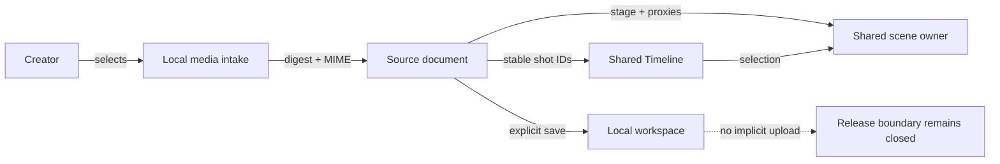
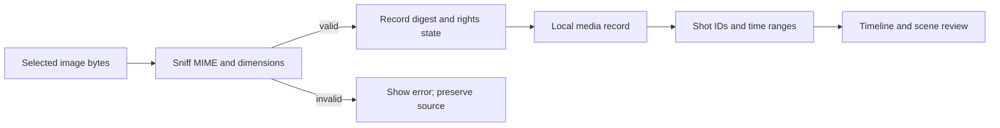
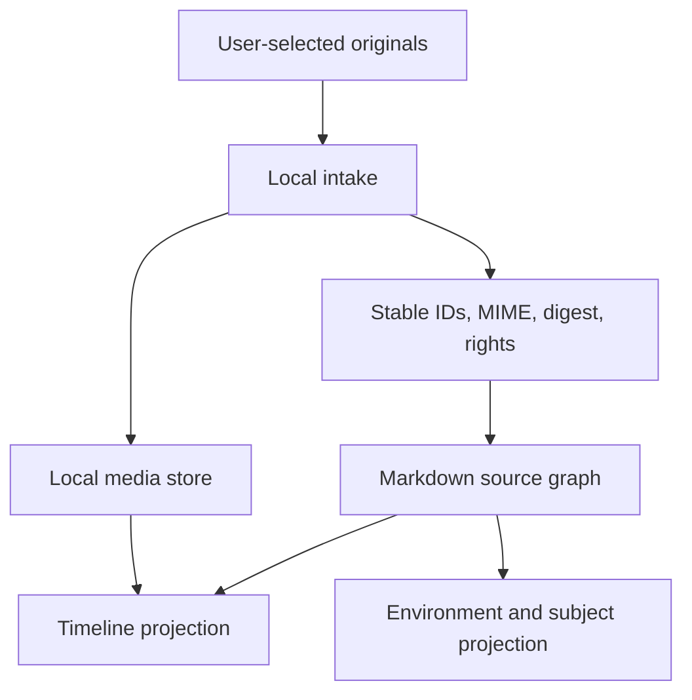
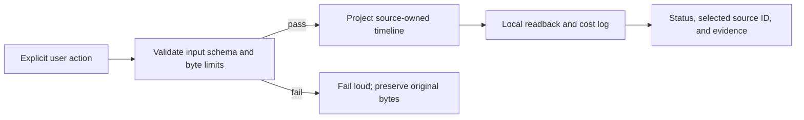
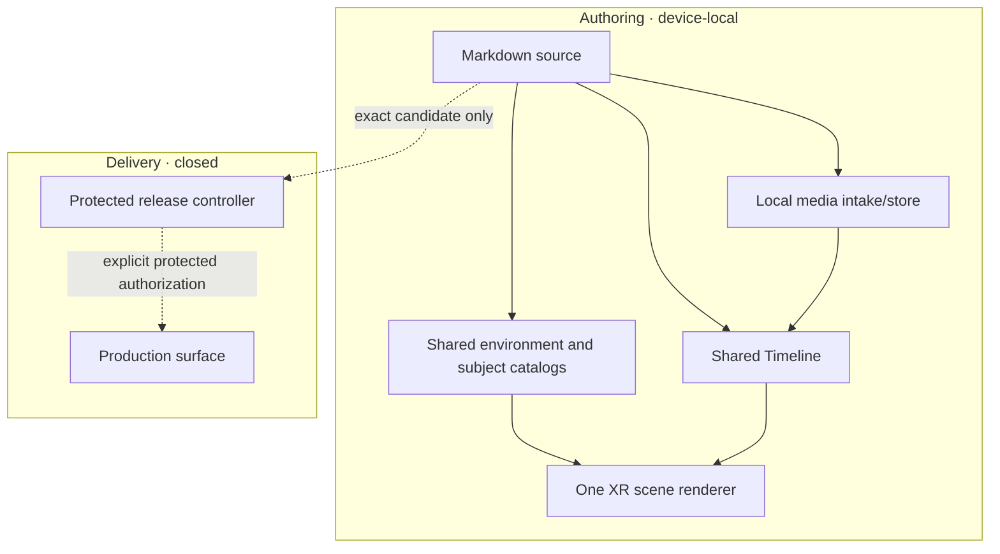

# Geo+XR Cinema Aigeddon

This joined record owns the cinema-specific product scope, architecture, decisions, smallest validation slice, and first-dollar experiment. Revision 0.12.0 records delivery evidence for the existing provider-neutral cinematic workspace while retaining the local Hong Kong scene, shared source-backed Timeline, and existing media owners. It does not claim
native runtime readiness, persisted shot-to-actor joins, offline/mobile proof, image rights, or GTM proof.

## Authority and continuity

PRD, TAD, ADR, MVP, and GTM share continuity PLAN-GEO-XR-CINEMA-AIGEDDON at revision 0.10.0.
This document consumes the existing universal Geo+XR contract and readiness-seed contract.
The region, artwork, and story remain replaceable inputs; they do not become runtime assumptions.

The workspace seed is registered with a local Geo+XR preview, Media/Assets, and Timeline as its
opening presentation. It does not auto-start a simulation. Local implementation registers the
optional fictionalized stage, adds a source-backed image timeline, and imports manifest-selected
images into existing browser-local media storage. A live browser preview rendered nine timecoded
contact-sheet crops after successful import. Product readiness remains undocumented at both local
and delivered surfaces; the runtime and device gates below remain open.

### Implementation checkpoint — 2026-10-13

Observed in the task worktree with `AG_DEV_SOURCE_MODE=task npm run dev` at `http://127.0.0.1:5173/`: the seeded BottomPanel Timeline rendered nine ordered shot markers over 15 seconds; all nine supplied
files passed SHA-256 and byte-signature checks, were stored in the existing browser-local media store,
and the contact-sheet crops appeared in the timeline. The explicit Timeline action handed the canvas
from Geo to the existing XR owner and opened the shared Media panel; Media reported 9/9 local assets
and displayed the new `Hong Kong SAR · Cinema Blockout` plus existing Subjects & Props. After a browser
reload, the imported contact-sheet crops rendered again from local storage. Source originals were not
edited or committed. `npm run workspace-seeds:authority`,
`npm run typecheck --workspace=@agentic-graph/canvas`, and `git diff --check` pass on this worktree.
The XR authoring surface's WebGL status is not a run-ready-demo or device-readiness claim. Rights,
shot/camera/actor persistence, offline replay, mobile accessibility, exact integrated-head checks,
delivery, and Production remain unproved.

### Geo+XR fidelity checkpoint — 2026-10-13

The Cinema action selects the seed's existing `hong-kong-cinema` stage, opens shared Geo+XR, Media,
and Timeline owners, fits a local preview, then reasserts the selected shot after MapLibre mounts.
The panel retains the regional context label and states that stage structures have no geotags. A live
2026-10-13 browser session centered shot 01 at 114.1588, 22.2856 and zoom 21.66, then switched shot
02 to its AI control-room camera and local set. Waterfront lighting, interior shells, rain, refined
character silhouettes, and the map grade remain locally authored; no landmark alignment or photoreal
model parity is claimed.

A prior development HMR build emitted a React maximum-update-depth error while an experimental
automatic fit effect was present. That effect was removed; a fresh reload rendered the current
Timeline without a new React error. Earlier console records remain historical evidence. The preview
uses a presentation anchor and meter-scale fictional stage; it does not establish physical
correspondence, shot geotags, native runtime readiness, device/Safari behavior, offline replay, or
publication.

`npm run typecheck --workspace=@agentic-graph/canvas`, `npm run workspace-seeds:authority`, and
`git diff --check` pass after this correction. These local checks do not establish physical
correspondence, native runtime readiness, device/Safari behavior, offline replay, or publication.

### Shared Timeline and choreography checkpoint — 2026-10-13

The live `npm run dev` page renders nine shot clips and five source-owned proxy tracks in the shared
15-second/24-fps Gantt transport: two performer motion presets plus keyed sedan, crate, and debris
movement. Seeking performer and debris marks moves the shared playhead; a clean browser run advanced
from 0:00 to 0:02 at frame 47, sampled both performers at keyed positions, and kept the map centered
on the Hong Kong local preview. Six actor/prop targets projected into that viewport. Media/Assets
remains the sole importer; no second clock, renderer, catalog, or schema was added. Save/reload and
device playback remain unverified.

`npm run workspace-seeds:authority`, canvas typecheck, and `git diff --check` pass. This proves local
source preview, playback, and seek interactions only; save/reload, shot-to-actor joins, device/mobile/
offline use, rights, native runtime readiness, delivery, and Production remain unverified.

## PRD — Product requirements

### Problem and hypothesis

A creator with a set of concept images and embedded shot timings must currently move between image
files, a separate timeline, and a separate spatial blocking surface. That handoff risks losing asset
identity, shot timing, or the relationship between a camera move and a still reference.

The inspected inputs were in `../joohwee/undocumented-draft/cinema-draft/image`, relative to the
canonical source checkout; that sibling path does not resolve from this managed worktree. One
nine-panel, 15-second reference sheet and eight supporting images were inspected there. This proves
that the supplied files exist; it does not prove that multiple buyers experience this friction or
will pay to solve it. The product hypothesis is that one local, source-owned project can connect still-image
references, shot markers, environment kits, subjects, props, and camera/actor blocking with fewer
manual transfers.

### Customer, buyer, and job

| Role | Hypothesized job | Current evidence | Gap |
|---|---|---|---|
| Story or previz creator | Turn concept art into a short, editable shot plan | One supplied image set contains characters, locations, and a timecoded contact sheet | No creator interview or repeat-use observation |
| Small production operator | Review staging and camera intent before a heavier render workflow | Existing code has reusable environment and subject catalogs plus Timeline owners | No buyer, budget, or workflow validation |
| Reviewer or collaborator | Trace each shot to its source image and preserve timing | Image filenames and contact-sheet timecodes are inspectable | Rights, provenance, and cross-device reopen are unverified |

Primary segment is a hypothesis: independent creators or small studios preparing short cinematic
previz. The beneficiary is the person reviewing a shot sequence. The payer may be a creator who
values reduced setup time. No market-size, conversion, or willingness-to-pay number is asserted.

### User journey

| Stage | User action | Surface | Target outcome |
|---|---|---|---|
| Prepare | Select local images and inspect names, bytes, dimensions, and rights status | Source Files / Media import | Exact local assets are identified; invalid bytes or unknown rights are visible |
| Block | Choose an environment kit and place available subject/prop proxies | FloatingPanel Media / Assets | One shared scene source owns the stage and placed objects |
| Sequence | Add shot markers and bind each marker to a still or contact-sheet region | BottomPanel Timeline | A 15-second timeline retains nine ordered shot identities |
| Review | Scrub, inspect framing, and compare a shot with its source image | Timeline and shared scene | Image, camera, and actor state agree at each marker |
| Save or share | Save the source document; share only after an explicit rights and storage decision | Source Files | Authored data is recoverable; no implicit upload or publication occurs |

### User stories, criteria, and VCCs

| ID | Story and acceptance criterion | Verification condition |
|---|---|---|
| PRD-CIN-01 | As a creator, I want local references tied to their manifest identity. Given the nine selected files, when intake completes, then original bytes and names are retained locally under digest-derived IDs, MIME is sniffed from bytes, and unknown rights remain visibly unverified. | VCC-CIN-01: Import the supplied set, verify nine exact digests and supported signatures including PNG bytes under `.jpeg`, reject unsupported content and never fetch the sibling path. Dimensions and per-asset rights records remain future scope. |
| PRD-CIN-02 | As a creator, I want an optional fictionalized Hong Kong cinema blockout while keeping the core replaceable. Given the shared catalog, when the entry is shown, then its limitation is clear and existing stage/renderer ownership is retained. | VCC-CIN-02: Verify catalog/UI projection and selected-shot camera handoff; stage removal and renderer restoration remain unverified. |
| PRD-CIN-03 | As a creator, I want timecoded references and animatable subject/prop proxies on one clock with configurable control. Given the seed timeline, Agent (AI/LLM/MCP) owns edits by default; selecting Human enables direct edits, and camera framing, SHOOT, and BottomPanel use the same sampled key at the playhead. | VCC-CIN-03: Browser observation confirms nine ordered clips, six subject/prop tracks, shared seeking, and matching camera optics across both panels; verify Human edits target the active key and MCP writes fail closed in Human mode. Save/reload and persisted joins remain unverified. |
| PRD-CIN-04 | As a mobile or offline user, I want the imported project to remain usable without external services. Given a completed local import, when the network is unavailable at a 375 × 812 viewport, then review, selection, scrub, save, and exit still work. | VCC-CIN-04: Run the named local browser/offline viewport gate after implementation and record the exact candidate and browser observation. |
| PRD-CIN-05 | As an asset owner, I want redistribution blocked until provenance is complete. Given a missing or incompatible rights record, when export/publication is prepared, then the media is omitted and the reason is shown. | VCC-CIN-05: Verify unknown rights fail closed for export while local private preview remains available. |

VCC-CIN-01 through 03 have partial implementation evidence only; VCC-CIN-04 and 05 are not run.
No complete VCC has passed, so the local or delivered product rung does not advance.

### Success metrics and time-to-value

| Metric | Baseline | Target | Window and evidence |
|---|---|---|---|
| Actions from selected image folder to first reviewable shot plan | Not measured | At most 5 explicit actions | Timed first-use observation |
| Time to first reviewable shot | Not measured | At most 5 minutes after files are selected | Clean local workspace walk-through |
| Shot/source alignment | 9 marker IDs and 9 contact-sheet crop indices rendered in one local browser session | 9 of 9 references survive exact digest readback; save/reload not measured | Exact import proof observed; rerun after persistence and shared mark joins |
| Offline use after import | Not measured | Review and edit remain available offline | Browser offline observation |
| External model calls and runtime network calls | No new runtime path proposed | 0 | Network and cost log observation |
| Monthly infrastructure/token spend | Not measured for the feature | $0 incremental target | Dependency and deployment-model audit |
| Local / delivered readiness | undocumented / undocumented | Advance only from exact VCC evidence | ADLC source and delivery receipts |
| ROI score | No observed frequency or build-cost baseline | Unscored until discovery | Owner records observed pain, cadence, and implementation hours before recalculation |

TTV estimates are hypotheses, not measured outcomes. User time, image storage, support time, and
future optional hosting remain unpriced.

### MoSCoW priority and min-viable scope

| Tier | Capability | Priority basis |
|---|---|---|
| Must | Local image intake with MIME, digest, provenance, and fail-closed rights status | Lowest-risk step that establishes identity for every later panel |
| Must | Reuse the existing environment and subject/prop catalog owners | Near-built path; avoids a second library or renderer |
| Must | One source-owned 15-second clock with nine image clips and reusable performer/prop motion marks | Closes the contact-sheet and blocking handoff without a second Timeline |
| Must | Local save, offline review, mobile layout, accessible controls, and explicit exit | Preserves the free, device-local MVP |
| Should | Optional Hong Kong-specific scene kit behind the shared environment contract | Adds scene utility without regional coupling in the core |
| Could | Crop previews for the nine panels using normalized source rectangles | Useful only if a measured review task needs per-panel crops |
| Won't | Live map/geocoding, network asset search, paid generation, account sync, automatic publication, or production deployment | Not needed for first value; cost, rights, and operational proof are absent |

Min-viable delivery is one local document, one imported image set, one selectable environment, five
or fewer neutral blocking proxies, nine shot markers, and one review/save/exit loop. It does not
generate video or claim a geospatially accurate Hong Kong model.

### Dependencies, exclusions, and ecosystem outcome

Dependencies are the existing source document, local image import/storage, the shared scene catalog,
the existing Timeline surface, and a browser with the current local Canvas runtime. The MVP adds no
external provider, model, paid plan, hosted service, or native-only API.

Excluded: public distribution of the supplied art before rights are recorded; real-person identity
claims; authoritative maps or coordinates; 3D reconstruction from the character sheets; audio/video
generation; multi-user editing; payment collection; Production activation.

Target outcome: a creator can inspect a locally imported reference, place an animatable catalog
subject or prop in a reusable environment, and scrub a shot marker that resolves to the same still after reload. Observe
the first five local creator sessions; record task time, failed imports, missing references, and
repeat use. Do not claim a reduction until a baseline and target are measured.

### Reuse outcome

The near-built path extends existing panel, scene, asset, and timeline owners. It avoids a new
catalog, a second Three scene, a parallel Timeline, or a media URL registry. The cinema adapter only
projects source-owned shot IDs into the shared Gantt lane contract and reuses its ruler geometry and
transport. Baseline setup time and duplicate-work frequency are unknown; measure them in the first
five observed sessions.

## TAD — Technical architecture

### Reference implementation — inspected codebase grounding

Code inspection used exact source revision 3b4dbb50bd86dd946d0d5b10e0cf97cad77d412e. These are
reference implementation names; the feature contract remains provider- and project-neutral.

| Existing owner | Observed responsibility | Planned reuse | Grounded gap |
|---|---|---|---|
| canvas/src/features/command-menu/XrMediaLibraryPanel.tsx, XrMediaLibraryPanel | XR Media panel exposes environment selection, featured asset selection, Terrain / Environment Kits, and Subjects & Props categories/search | Keep the optional stage in the shared catalog and mount the source-aware local reference gallery in Media | Geo+XR/Media activation and regional framing observed; native runtime and rights/export policy remain open |
| canvas/src/features/three/xrSceneLibrary.ts, XR_MOTION_REFERENCE_STAGE_PRESETS and XR_SCENE_LIBRARY_ASSETS | Owns stable stage presets and built-in performer/vehicle/prop catalog records | Added `hong-kong-cinema` night-waterfront geometry and procedural animatable character profiles | Concept sheets remain visual references; no image-derived mesh or verified geospatial alignment is claimed |
| canvas/src/features/gitgraph/TimelineBottomPanelView.tsx, canvas/src/features/cinema/CinemaShotTimeline.tsx, `useGeoXrOverlayPublisher.ts`, and `xrMotionReferenceModel.ts` | Shared Gantt transport owns playback, ruler, XR camera/subject lanes, and source-authored cast marks | Added nine shot clips beside existing performer presets and keyed prop motion; current-session staging reuses `kgXrMotionReference/v1` | No persisted camera/actor joins, save/reload proof, or independent per-shot still mapping |
| canvas/src/features/three/XrSceneStage.tsx, XrSceneStage | Selects shared XR stage authority | Retain the one shared scene renderer; do not mount a cinema Canvas | No new independent Three scene is allowed |
| canvas/src/lib/storage/localMediaFileStore.ts and canvas/src/lib/storage/uploadedMediaStorage.ts | Existing local media storage owners | Reuse the IndexedDB local media store, key records by manifest digest, sniff bytes and lazy-load gallery previews | Rights records and export enforcement are not connected to this storage owner |
| docs/workspace-seeds/agentic-graph-ar-vr-xr-runtime-readiness-demo.md | Existing source-backed XR readiness reference and choreography seed | Reuse its source-owned marks, explicit permission, and honest readiness boundaries | Its story and assets do not establish this feature's import or timeline behavior |

The reference seed is a runtime-readiness inspiration only. Its previous evidence does not transfer
to this feature or candidate.

### Journey-to-system mapping

| Journey stage | Workflow | Data flow | Harness / orchestration | Owner |
|---|---|---|---|---|
| Prepare | User selects local images | Bytes → sniffed MIME/digest → local media record | Deterministic validation; no AI | Existing local Media/Source Files owner |
| Block | User selects a kit and proxies | Source-owned scene ID → catalog projection | Existing XR stage invocation, explicit user action | Environment and subject catalogs |
| Sequence | User assigns shot IDs and motion marks | Local references + time ranges + existing cast tracks | Bounded local validation, no model call | Shared Timeline and source document |
| Review | User scrubs and inspects | Selected shot → exact media reference and scene marks | Local browser projection | Shared Timeline and scene renderer |
| Save / exit | User explicitly saves or exits | Markdown plus local media records | Preserve bytes on malformed or stale state | Source Files and local store |

### Topology and boundaries

Version 0.5.0 is a local-authoring implementation candidate. No delivery node is active.

| Node | Role | Type | Lane | Connection | Residency |
|---|---|---|---|---|---|
| Source document | Authored graph and shot metadata | Markdown/frontmatter | Authoring | User edits → parser | Local checkout or user-selected workspace |
| Local media intake | Validates and stores imported image bytes | Browser module | Authoring | File picker → digest/MIME → local store | Device-local |
| Environment and subject catalogs | Supplies stage and proxy metadata | Shared domain modules | Authoring | Source IDs → shared scene owner | In-memory projection of source |
| Timeline projection | Displays source-owned shot clips and contact-sheet crops inside the shared ruler; selecting a clip seeks the existing XR playhead | Shared Gantt transport plus lazy cinema lane adapter | Authoring | Frontmatter + digest-checked local media → shared selection/playback | Device-local |
| Release controller | Builds and reviews an exact integrated candidate | Protected repository workflow | Mirror / delivery | Only after separate authorization | Owner-controlled |
| Production target | Not in this MVP | Protected deployment surface | Delivery | Closed | No effect in this task |

### Five required flows

#### User journey flow

#### Workflow flow

#### Data flow

#### Harness and orchestration flow

No AI is required in the MVP. Keep the local pipeline deterministic and bounded.

#### Topology flow

### Component responsibilities and budgets

| Component | Responsibility | Proposed interface | Bound |
|---|---|---|---|
| Local intake adapter | Read selected bytes, sniff MIME, hash, and preserve originals | Existing local media store plus cinema manifest adapter | Explicit selection; PNG/JPEG/WebP signatures; maximum 12 MiB per file; no remote reads |
| Source-owned shot model | Parse stable shot ID, time range, contact-sheet panel index, and asset manifest | Seed frontmatter parser | 9 shots, 15 seconds; invalid/duplicate IDs or invalid intervals fail closed |
| Regional environment kit | Supply optional fictionalized blockout data to the shared catalog | Existing environment preset contract | Optional static preset; no provider, map dependency, or second scene |
| Timeline projection adapter | Project source shot intervals and contact-sheet crops into the shared Gantt lane and seek its existing clock | `VideoSequenceTimelineInsertedLane`, `TimelineTransportTimeAxisClip`, and shared ruler geometry | No second card strip, clock, Timeline, importer, or panel-local registry; actor/camera persistence remains open |
| Preview projection | Use object URLs for local assets and crop the contact sheet in the browser | Browser-native image decode and CSS background crop | Gallery images lazy-decode; no derivative is generated; mobile memory remains unmeasured |

Proposed implementation sprint cap: one day, at most 8 changed source/test/document paths, 4 new runtime
modules, and 24 KiB of code/test text. Keep always-loaded delta at zero where possible; lazy-load the
regional kit and image preview. Stop and re-scope if the shared Timeline requires a second authority,
the byte cap cannot be met, or any external service is required. Refresh the estimate on source drift.

### Data lifecycle and privacy

| Data | Owner | Retention / recovery | Boundary |
|---|---|---|---|
| Original image bytes | User-selected local media record | Preserve exact bytes and digest; explicit delete is a separate user action | Never fetch from a sibling path or upload on mount |
| Preview derivative | Local media presentation adapter | Regenerable from original; retain only if it reduces repeated work | Lazy, bounded, and linked to original digest |
| Rights/provenance record | Source document | Keep origin, license, attribution, and redistribution state | Unknown rights block public export |
| Shot, environment, and subject IDs | Markdown source | Git-diffable, user-owned, replayable | No hidden registry or last-write-wins |
| Runtime selection state | Existing UI/runtime owner | Ephemeral unless explicitly saved by the owner | No parallel local storage key |

Do not persist camera frames, sensor data, face identity, or private source paths. No capture permission
is needed. Treat contact-sheet text as authored creative content, not verified geospatial data.

### Quality, failure, and recovery

| Attribute | Scenario and target | Validation |
|---|---|---|
| Correctness | Extension says JPEG while bytes are PNG | Byte-signature check and exact digest readback |
| Reliability | Invalid image or malformed shot join | Fail loudly and keep original bytes untouched |
| Performance | Nine large source images on a mobile browser | Lazy preview, one image decoded at a time, generated preview below 500 KiB |
| Offline | Connectivity drops after explicit import | Local preview, selection, timeline, save, and exit remain available |
| Accessibility | Timeline on 375 × 812 | Keyboard/touch access, visible focus, semantic names, no hover-only control |
| Privacy | User declines camera or has no camera | Full storyboard path still works without camera/microphone permission |
| Cost | No models, hosted maps, or external media calls | 0 model tokens and $0 incremental service target |
| Recovery | Save or projection fails | Retain last known source bytes and restore the prior scene/panel state once |

### Invocation and interoperability

Reference implementation routes already present in the inspected source include stage and transform
invocations, plus the shared local XR scene control surface. Reuse those typed owners for explicit
operator actions. Do not add a second slash command, semantic tag, or binding for the same operation.

| Capability | Surface | Input/output owner | Mode and effect | Evidence / gap |
|---|---|---|---|---|
| Select an XR stage | Existing /xr.stage @stage route | Existing scene invocation contract | Explicit local source mutation | Present in the reference seed; candidate-specific proof remains required |
| Place or transform a proxy | Existing /xr.transform @subject #transform route | Existing catalog and scene controller | Explicit local source mutation | Reuse; do not claim supplied stills become 3D |
| Import images | Explicit file picker in the shared Media/Assets panel | Existing local media store keyed by manifest SHA-256 | User-selected bytes only; source signatures and digests checked | Live local import and contact-sheet rendering observed; BottomPanel does not import; dimensions and rights records are not implemented |
| MCP / WebMCP scene control | Existing adapter boundary | Existing typed scene controller | Local and approval-gated by current owner | No new tool identity or background execution in this plan |
| Image timeline binding | Shared BottomPanel Gantt transport with a source-frontmatter shot lane | `cinemaShotTimelineModel`, `CinemaShotTimeline`, and shared timeline lane/time-axis utilities | Shot selection seeks the shared transport; XR motion projection uses existing stage authority | Nine clips, a 15-second/24-fps clock, and source-owned shot-to-camera/cast staging observed; persistence and new invocation remain open |

Discovery/read routes remain zero-token. Any future AI-assisted analysis must be optional, harnessed,
budgeted, logged, and replaceable; it is outside the MVP.

### Deployment and rollback boundary

This lane changes source, documentation, and the seed registry. It does not run a deploy, publish,
production promotion, or rollback. A later product change must use the repository's
protected release workflow and exact candidate receipts. The only production path is the protected
release workflow with explicit candidate-bound authorization. Source merge is not deployment proof.

For this local implementation candidate, rollback means a reviewed source revert plus removal of the
seed registry entry if the feature is rejected. Browser-local imported records are user data and are
not removed by source rollback. It does not mean deleting a branch or changing Production runtime state. A later runtime
rollback must use the product owner's retained production predecessor and readback; Git reset is not
runtime rollback.

## ADR — Architectural decisions

### ADR-CIN-01: Keep one source-owned Timeline

**Context:** the current 3D XR route presents actor transforms and camera marks; the 2D sequence route
presents image/video sequencing. A second cinema timeline would duplicate ordering and selection.

**Decision:** retain the shared Gantt transport and insert cinema shots through its lane contract.
Use existing `kgXrMotionReference/v1` source-owned cast tracks for performer poses and prop keyframes;
the shared ruler seeks the same 15-second/24-fps playhead. Reference importing remains in Media/Assets.
Shot-to-actor IDs resolve in the current local session; persistence remains unproved.

**Alternatives:** keep manual slide references without timeline binding; or build a dedicated cinema
panel. Manual linking leaves the requested seam open; a dedicated panel creates a second owner.

**Consequences and recovery:** the projection adds no second Timeline, card strip, clock, importer, or
runtime registry and keeps existing camera/actor owners intact. Extend the source contract only after
a save/reload and shared mark migration design is verified; remove the adapter if it cannot reuse the
shared lane contract.

### ADR-CIN-02: Keep regional data in an optional kit

**Context:** the existing catalog has reusable city and neutral blockouts; this candidate adds an
optional Hong Kong cinema blockout.

**Decision:** model the fictionalized Hong Kong cinema setting as an optional preset using the
existing stage interface. Its locally authored night-waterfront geometry is not map-derived. Keep
regional labels and geometry within that optional preset; the universal renderer and Geo+XR contract remain unchanged.

**Alternatives:** relabel Singapore as Hong Kong; fork the XR renderer; or add a required Hong Kong
default. All three confuse source truth or create regional coupling.

**Consequences and recovery:** the preset is removable by stable kit ID and absent from unrelated
documents. Stage selection/runtime restoration still need proof. Use a neutral blockout when absent.
Revisit if a verified local geometry source and portability license become available.

### ADR-CIN-03: Import user media locally and gate distribution

**Context:** the supplied images are outside the product repository, are untracked in their source
checkout, and four files have PNG bytes under a JPEG suffix.

**Decision:** treat them as operator-selected local inputs. Sniff actual bytes, retain original names
and digests, store originals in the existing local media store, and create previews only at render
time. The UI marks rights as unverified; export enforcement is not yet connected. No browser fetch of
local repository-relative paths.

**Alternatives:** copy originals into the product repository; fetch them from a sibling path at
runtime; or trust extensions. Copying creates provenance and distribution risk; sibling fetch is not
portable; extension trust is incorrect for the observed inputs.

**Consequences and recovery:** local import is explicit; source originals remain untouched; the
local preview remains usable while rights are unknown. Public packaging must stay blocked by process
until a product-owned rights/export gate exists and the owner supplies a redistributable provenance
record.

## MVP — Smallest evidence-backed slice

### Demo skeleton and scope

1. Open the registered seed into a non-running Geo+XR cinema preview with Media and Timeline visible.
   **Implemented; verify on fresh seed selection.**
2. Select the nine source images locally and verify signatures and digests without modifying source
   originals. **Implemented and observed in the local browser.** Dimensions and rights state are not
   captured per asset.
3. Reuse the shared stage and subject/prop catalog. **The procedural waterfront kit and animated
   cast profiles are registered; stage switching, removal, and scene restoration still need proof.**
4. Parse nine stable shot markers from the supplied contact sheet's 0–15 second timecodes.
   **Implemented and observed.**
5. Crop the contact sheet into nine time-axis clips in the shared Gantt lane. **Implemented and
   observed.** Shot 04 seeks the shared playhead to 5.1 seconds; separate still assets per shot are
   not bound.
6. Review performer/prop marks, save locally, reload offline, and exit. **Shared tracks, seeking, and
   continuous playback are observed; source persistence, shot joins, offline behavior, and mobile
   layout are not yet verified.**

### Evidence register

| VCC | Named check or observation | Current result | Surface |
|---|---|---|---|
| VCC-CIN-01 | Import exact source set; verify SHA-256, byte signatures, and preview | Partial: 9/9 exact files imported to local browser storage; PNG under `.jpeg` signatures accepted; thumbnails visible. Invalid fixture and dimensions/rights checks not run. | Local UI |
| VCC-CIN-02 | Catalog entry is optional, retains shared stage/renderer ownership, and Skills & Commands search resolves cinematic intent through the existing `/video-agent` source with canonical `#`/`@` bindings | Partial: Geo+XR/Media activation selected the blockout and centered the local preview within Hong Kong SAR; live Skills & Commands search for “cinematic” returned the source-backed `/video-agent` command and canonical bindings. Removal and renderer restoration remain unverified. | Local UI |
| VCC-CIN-03 | Nine-shot source alignment, subject/prop motion, and single-owner camera framing on the shared clock | Partial: 9 clips, 6 proxy tracks, 18 camera marks, staged set/cast changes, and continuous playback at 24 fps observed; at 10.2 s, FloatingPanel Framing and SHOOT both read the 32 mm Timeline key. Owner gating, save/reload, per-shot asset references, and persisted joins remain unverified. | Local UI |
| VCC-CIN-04 | 375 × 812 offline browser walk-through after import | Not run | Authoring |
| VCC-CIN-05 | Unknown-rights export gate | Not run; UI discloses unknown rights, but an export gate/rights record is not implemented. | Authoring |

Do not advance the product rung from these planned checks. The local and delivered rungs remain
undocumented until exact evidence is recorded.

### Threat and failure cases

| Case | Required behavior |
|---|---|
| Missing or malformed image bytes | Reject that import with a typed reason; preserve source |
| MIME extension mismatch | Use byte detection and retain original filename/digest |
| Duplicate file or changed bytes | Reconcile by exact digest; never silently overwrite a different asset |
| Unknown license or attribution | Keep private local review available; block public export |
| Stale Timeline draft | Stop write, preserve current bytes, and ask for a fresh source read |
| Missing kit | Use Street Grid blockout or remain in 2D; do not load a second world |
| Offline or unsupported device | Keep local editing available; degrade preview and report capability |
| Browser exit during save | Preserve last accepted source revision and replay only an exact candidate |

## GTM — First-dollar learning path

### Position and alternatives

Offer hypothesis: a free, local-first, source-owned way to turn existing still-image concepts into a
replayable shot plan with optional spatial blocking. Manual slides, a generic video editor, and a
full 3D editor remain alternatives. The proposed distinction is traceable local source plus a shared
Timeline and reusable spatial catalogs, not a claim of superior rendering.

### Ranked first-dollar path

| Rank | Step | Pain and value | Evidence needed |
|---:|---|---|---|
| 1 | Observe five creators moving supplied stills into a shot review | Validate whether repeated asset/timeline handoffs are real pain | Timed tasks, failed actions, repeat-use intent |
| 2 | Demonstrate the smallest reuse path through the existing catalog and Timeline | Minimize implementation before adding a regional kit | Exact source-to-preview identity and setup time |
| 3 | Offer one optional $1 guided setup/support session after a creator completes a local project | Test a first-dollar signal without a software plan, add-on, or paid runtime dependency | Voluntary payment evidence; none collected or requested in this task |

The software remains FOSS/free-tier compatible with no paid plans, add-ons, overages, or required
provider. The one-time support-session idea is an unvalidated service hypothesis, not a product price
or payment integration.

### Acquisition, conversion, retention, and support

Use an open-source demo and unpaid creator communities first. Activation is one local project saved
and reopened. Conversion learning is the optional $1 support-session experiment. Retention is a
second project created within 30 days. Record support minutes, import failures, and asset-rights
questions; do not count downloads as repeat demand.

Sales cycle, reachable audience, market size, support capacity, and repeat-use baseline are unknown.
Market sizing is deferred until discovery; use two independent sizing methods and publish ranges and
assumptions before any investor or public market claim.

### Operations, obligations, and financial viability

Bootstrap with existing local runtime and FOSS dependencies; target incremental infrastructure and
token cost is $0. No paid storage or generation is required. Actual developer time, device storage,
and customer support cost remain unmeasured. Do not convert these unknowns into zero-cost claims.

The owner must record rights, attribution, and distribution scope for each asset before public
packaging. No location coordinates, personal identity, or biometric data are collected. Applicable
contract, copyright, privacy, and location obligations need owner review before distribution. No
supplier, employee, entity, or capital plan is evidenced; keep this bootstrapped and do not raise
capital for an unvalidated feature.

## Coverage record C01–C16

Every domain has one disposition. Counts are 9 covered / 7 deferred / 0 not-applicable; covered
applicable domains are 9/16. “Covered” means the planning decision and current evidence gap are
recorded, not that a VCC passed.

| ID | Domain | Status | Source / owner | Evidence or gap and next check |
|---|---|---|---|---|
| C01 | Purpose, customer, and pain | covered | PRD problem and customer / Product discovery | Supplied image set is observed; interview five creators before implementation baseline |
| C02 | Market and timing | deferred | GTM position / GTM discovery owner | No two-method sizing evidence; revisit after five interviews and reachable-segment definition |
| C03 | Offer and alternatives | deferred | GTM position / Product discovery | Manual alternatives are listed; no price or WTP evidence; test the $1 service hypothesis |
| C04 | Product and experience | covered | PRD journey and VCCs / Product architecture | Target and gaps recorded; run local/mobile/offline walkthrough after implementation |
| C05 | Architecture and data | covered | TAD reference implementation / Architecture owner | Existing source/catalog/Timeline owners inspected; prove joins and data lifecycle on exact candidate |
| C06 | Quality, security, and AI | covered | TAD quality and threat tables / Engineering owner | No AI or external runtime calls in MVP; prove MIME, rights, offline, and recovery gates |
| C07 | Decisions and tradeoffs | covered | ADR-CIN-01 through ADR-CIN-03 / Architecture owner | Decisions and alternatives recorded; revisit on measured creator evidence or rights change |
| C08 | Smallest validated slice | covered | MVP demo skeleton / Delivery owner | Scope is dependency-bounded; VCC evidence has not been collected |
| C09 | Acquisition through retention | deferred | GTM acquisition / GTM owner | Channels and metrics are hypotheses; observe five creators and one 30-day repeat window |
| C10 | Business operations | deferred | GTM operations / Operations owner | Support time/capacity are unknown; measure first five sessions before committing service level |
| C11 | Organization and obligations | deferred | GTM obligations / Asset owner | Source files are untracked and rights unknown; obtain license/attribution decision before distribution |
| C12 | Financial viability | deferred | GTM financial / Finance owner | Infrastructure target is $0; labor, storage, support, and unit economics are unmeasured |
| C13 | Capital and milestones | covered | GTM financial / Product owner | Bootstrap, no outside capital; next milestone is five observed sessions plus one VCC-ready local slice |
| C14 | ADLC execution | covered | Authority and continuity / Release owner | Scoped docs lane exists; no publish, deployment, or runtime receipt is claimed |
| C15 | Audience projections | deferred | GTM position / Product owner | No deck, business plan, or financial model requested or validated; revisit before an external investment handoff |
| C16 | Learning and next increment | covered | GTM first-dollar path / Product discovery | Continue only if at least 3 of 5 creators complete the local task and one repeats or requests guided setup; then review $1 signal |

Deferred rows retain their dependency, owner, and revisit trigger. No deferred market or financial
claim is required for this local implementation candidate.

## ADLC handover and next action

Development: PR #1707 merged at `9d8ccd9323f763f876923d0aa666e539783d0797` from lane head `5c619e3839cd88f7f82b76d3e5dc878acf6a40d5`; source-release receipt `c439325edf839674709464405f6aeea39ea49a3b5b3b8f1773ed629c27597326` binds the protected integration.

Production Release: GitHub Production Release run [38505103102](https://github.com/huijoohwee/agentic-graph/actions/runs/38505103102) succeeded for canonical candidate `ee3c8dd8dd887ffe4fe51c3df1d33702a976cf52`, candidate digest `c5a7de5012a89484b7ff28e731fe5554c4e60d0b7eba34d2590790147475c8fe`; the exact candidate has human authorization, deployment receipt `dd0309a126a1882a87a1b3c0453386da0c4168707749e5d20b3de326a0835f65`, publication receipt `a8783505432affd4d38387afa52fbb7d6476d31f50ceb86bb9d4bf2a9b114943`, and retained rollback identity.

Runtime: readback is verified by receipt `eca859d3f067b5df77df982c90c5b20e68ae6f2fb9d8eab4e79d75ff2d992485`; immutable, stable, and public route transport evidence passed. The full Development, Production, Runtime, transport, travel-mesh and rollback evidence is retained in [production-delivery-evidence-38505103102.json](../reports/production-delivery-evidence-38505103102.json), SHA-256 `26b37b0785ffe47029142d50a6d2c2632fc95dd4f573e14982cdc920f84cc777`.

The merged implementation lane is delivery-complete at that candidate. Its exact deployed disposition is still pending a committed ledger row. Next: merge this evidence-only documentation lane, then land one control-ledger-only change recording the PR #1707 deployed row and this report lane's no-deploy row. The existing production result is reused; no second deployment is needed. Merge authority for the follow-up evidence and ledger lanes remains separate.

Related work: the requested Agentic Canvas OS docs/SKILLS.md update remains blocked on native allocation reconciliation or a committed task plan; the Agentic OS dictionary remains unchanged under its pinned owner.
