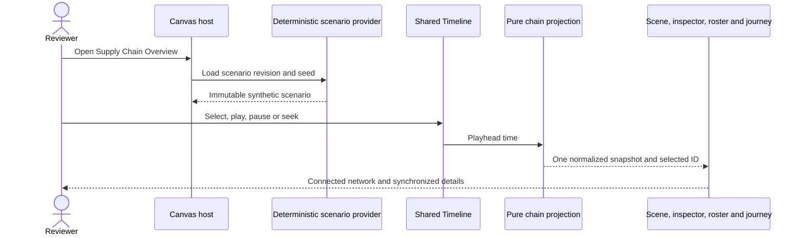
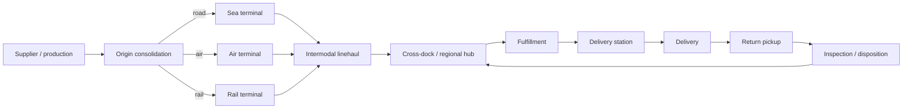

# Provider-neutral logistics supply-chain operations overview — PRD, TAD, ADR, MVP and GTM

This joined planning artifact at `logistics-supply-chain-operations-overview@0.2.0` updates the as-built record for the deterministic multimodal overview already in Canvas. It represents supplier and production origins, consolidation, road/rail/air/sea terminals, hubs, fulfillment, delivery and reverse logistics with synthetic data. This revision wires the active overview to the existing 3D-for-XR asset library and provides an offline schematic while retaining the shared read-only Timeline. It does not claim live connectivity, operating benchmarks, validated demand, deployment or production readiness.

## Evidence, scope and grounding

### Observed state

- **O-01 — user intent:** the user asks to keep the full multimodal chain, share documents without sign-in, and reuse the existing Media asset library and shared Timeline. Market demand remains unvalidated.
- **O-02 — current feature owner:** at Graph `ba488e7b8716538dc348172cb27c5505f881e2ab`, `SupplyChainOverview.tsx` already projects twelve facilities, three deterministic sample consignments, five transport modes including returns, operations detail, and a shared read-only Gantt Timeline.
- **O-03 — asset and host boundary:** `CanvasViewport.tsx` activates the supply-chain overview. The shared `openXrMediaLibrary` owner opens FloatingPanel → Media → 3D for XR; that library owns Terrain / Environment Kits and Subjects & Props. This revision adds an entry point instead of another catalog.
- **O-04 — network boundary:** online geospatial display uses the configured public map style. When the browser reports offline, the overview renders its locally generated schematic and keeps scenario selection and Timeline state interactive; no map tile is required for that fallback.
- **O-05 — data boundary:** scenario records remain synthetic and local. No carrier adapter, operational feed, service commitment, or production claim is added.

### Evidence register

| ID | Evidence class | Result | Limit |
|---|---|---|---|
| E-01 | User instruction | Complete logistics-chain scope; airport, port and other nodes must appear in the local scene. | Product direction, not market validation. |
| E-02 | Historical browser observation (2026-10-12) | Earlier local view showed the warehouse lesson before the supply-chain source was active. | Historical state; superseded by the current source and browser check. |
| E-03 | Historical source observation | Graph base `0fc6b404ea791308d2e7aba8be4f4b37424e9bc4` described the warehouse lesson before the supply-chain feature landed. | Retained for provenance; not the current feature inventory. |
| E-04 | Current source observation | Graph base `ba488e7b8716538dc348172cb27c5505f881e2ab` contains the supply-chain module, shared Timeline, shared XR asset library and geospatial host. | Source presence alone does not prove every VCC. |
| E-05 | Current source observation | Supply-chain scenario data, event projection and entity selection are implemented under `canvas/src/features/supply-chain/`. | Synthetic local records do not prove live operations or market demand. |
| E-06 | Binary inventory | No relevant tracked native executable, library, WebAssembly module or Node addon was identified in the admitted product paths. | No native-binary behavior claim is made. |

### Codebase grounding record

Current source observations below are pinned to Graph base `ba488e7b8716538dc348172cb27c5505f881e2ab`; E-02/E-03 above retain their earlier base as historical context. Changes stay in the admitted Graph lane and preserve the existing source owners.

| Owner | Existing source | Grounded capability | Gap this proposal adds |
|---|---|---|---|
| Canvas host | `canvas/src/components/CanvasViewport.tsx`; `canvas/src/features/supply-chain/useSupplyChainOverviewRoute.ts` | Activates the supply-chain workspace view. | Preserve explicit route activation and normal document ownership. |
| Scenario and operations UI | `canvas/src/features/supply-chain/SupplyChainOverview.tsx`; `supplyChainScenario.ts`; `supplyChainViewStore.ts` | Owns the synthetic network, projection, synchronized selection, filtering, event details and offline schematic. | No live feed or provider-specific data. |
| Shared replay | `canvas/src/features/gitgraph/GanttTimelineTransportPanel.tsx`; supply-chain timeline projection | Shared read-only transport is keyed to the deterministic scenario. | Keep one scenario clock across map, journey and event state. |
| XR asset library | `canvas/src/features/xr-v2/openXrMediaLibrary.ts`; `canvas/src/features/command-menu/XrMediaLibraryPanel.tsx` | Opens existing Terrain / Environment Kits and Subjects & Props in shared Media. | No duplicate catalog or asset package. |
| Geospatial host | `canvas/src/components/CanvasViewportGeospatialOverlay.tsx`; local supply-chain graph | Displays projected facilities and route geometry with the configured online basemap. | Offline interaction uses the local schematic; no tile is required for the fallback. |
| Runtime packaging | `agentic-canvas-os/README.md` | Product/runtime packaging boundary. | No package or provider dependency is proposed. |
| Workflow authority | `agentic-os/docs/START-WORKFLOW.md` | Bounded lane admission and protected release workflow. | Use for plan admission and implementation lifecycle only. |

## PRD — product intent

### Problem and users

**Problem hypothesis:** people reviewing a logistics flow cannot quickly see where goods are, which transport leg or facility handoff is active, what is delayed, and how delivery or return links to the original consignment when those facts are split across separate views. The current local XR lesson represents one facility task, so a learner cannot follow goods from origin through multiple transport modes to a destination and back through returns.

The pain, frequency, current workaround cost and willingness to pay are unvalidated. This proposal is an interaction and data-model prototype, not a claim that these conditions exist for a measured segment.

| Role hypothesis | Job | Buyer evidence |
|---|---|---|
| Network operations reviewer | Trace one consignment through facilities, transport legs, exceptions, delivery and return. | Intended user; no interview or usage evidence yet. |
| Facility or transport coordinator | Understand the current handoff, queue and resource context across connected sites. | Beneficiary hypothesis; no operational workflow observed. |
| Supply-chain educator or simulation author | Teach multimodal flow and exception recovery in a replayable spatial model. | Adjacent to the existing local XR authoring surface; adoption unvalidated. |
| Economic buyer | Unknown. | Pricing, budget owner, procurement path and geography are unvalidated. |

### Product outcome and journey

**Outcome:** in one overview, a reviewer can identify every modeled chain stage, follow one consignment and its linked return, inspect facility/resource context, and replay the same deterministic event sequence without confusing synthetic data with live operations.

**Journey:** open Supply Chain Overview → see the whole connected network and simulated-data marker → filter infrastructure/resources → choose a stage, facility, vehicle or consignment → inspect its event and handoff context → follow the linked journey on the shared Timeline → scrub or replay → inspect delivery or reverse-logistics outcome → reset to the full network.

**Role / action / outcome:** the operations reviewer selects a consignment; the synchronized scene, inspector, roster and timeline expose the same entity and current event; the reviewer can trace origin-to-destination and any return without changing the source record.

### Required chain model

The scenario must visibly connect and distinguish these functional stages:

1. Supplier / goods origin and production or assembly.
2. Collection, export preparation and origin consolidation.
3. Multimodal terminal transfer, with separate road, rail, air-cargo and sea-cargo facilities; air and sea sites must be recognizable in the overview without opening a warehouse detail.
4. Linehaul legs and intermediate transfer events.
5. Regional hub, cross-dock and sort operations.
6. Fulfillment or distribution facility and outbound preparation.
7. Delivery station, last-mile route, recipient delivery event and exception state.
8. Reverse-logistics request, pickup, return transport, inspection and disposition linked to the originating consignment.

This is a reusable chain topology, not a fixed jurisdiction, carrier, inventory system or facility taxonomy. A scenario may omit an optional mode only when the view labels that stage as unavailable; the MVP acceptance scenario includes road, rail, air and sea.

### Product requirements and VCCs

| ID | Requirement | Verification criterion (VCC) |
|---|---|---|
| A-01 | Overview opens with the complete network framed: origin, production, air terminal, seaport, rail terminal, cross-dock, regional hub, fulfillment, delivery station, destination and returns are visible or discoverable by labeled controls at the supported desktop overview size. | Browser smoke captures the full-network state and asserts the required facility labels and mode indicators are present and visible. |
| A-02 | A single deterministic sample consignment traverses origin → production → terminal transfer(s) → linehaul → hub → fulfillment → last mile → delivery; a return is linked to that same consignment. | Domain projection returns a continuous ordered event trace and the return retains the originating consignment ID. |
| A-03 | Every dashboard metric, scene badge, selected detail, roster row and timeline event derives from one immutable scenario snapshot and selected playhead time. | Projection checks reconcile counts and selected IDs across each surface for start, handoff, exception, delivery and return samples. |
| A-04 | Selecting a facility, resource, consignment, chain stage or event synchronizes selection across scene, inspector, roster and journey; focus can be stopped, reset or returned to whole-network view. | Browser smoke selects one node and one consignment, verifies synchronized IDs, then exercises stop-follow and reset. |
| A-05 | Infrastructure, moving resources and all-entity filters plus label visibility and search operate on stable IDs without deleting scenario data. | Browser smoke toggles each filter and confirms the expected visible groups while selected entity state remains valid. |
| A-06 | Simulated provenance is persistent and explicit. The UI exposes scenario source, deterministic seed/revision and event time; no live indicator appears for synthetic records. | UI inspection and source projection confirm all demo entities have simulated provenance and live status cannot be inferred from an absent adapter. |
| A-07 | Replay, seek, pause and speed use the shared Timeline transport. Resetting to the same scenario revision and time reproduces the same entities and events. | Replay the same deterministic seed/time twice and compare the normalized domain snapshot and selected journey state. |
| A-08 | After the app shell loads, core scenario use remains available offline without map tiles, data service, login or provider credentials. | Disable network in the browser; the local schematic, details, search, filters and shared replay remain functional. |
| A-09 | The scene has a readable non-XR network/map view and keyboard-operable equivalent navigation. Responsive panels never permanently obscure the selected entity or Timeline controls. | Keyboard and browser viewport review at wide, split-workspace and narrow layouts; inspect focus order and a 2D/network fallback. |
| A-10 | Generated geometry and labels are original, generic and local to this feature; no external operational feed or visual asset is required. | Source and dependency review finds the scene assets locally authored and no new external runtime dependency. |
| A-11 | The active overview reuses the existing Media → 3D for XR library for Terrain / Environment Kits and Subjects & Props, with no second asset catalog. | Browser check activates **3D assets** and verifies the shared Media panel opens in `xr-3d` mode with the existing kit and subject/prop sections. |

### Scope and explicit boundaries

**MVP includes:** local full-chain topology; synthetic facilities, consignments, legs, resources, events, exceptions, delivery and linked return; recognizable procedural air/sea/rail/road scene elements; KPI strip, stage navigator, contextual inspector, synchronized roster/journey; local search/filter/labels; deterministic shared-Timeline replay; visible provenance; offline and non-XR fallback.

**MVP excludes:** live provider connectors; operational dispatch or vehicle control; customs or regulatory decisions; geocoding of real facilities; real customer, worker, recipient or shipment information; production inventory accounting; identity/tenant configuration; forecasting or optimization; autonomous agents; analytics claims; public deployment and commercial offer.

If a later increment introduces live data, it needs a separate admitted provider contract, source-specific authentication and freshness semantics, tenant/access control, privacy/security review, error and stale-state behavior, licensing, and data-retention rules. It must not silently mix live and synthetic records.

### Success measures and economics

| Measure | Target | Method / present evidence |
|---|---|---|
| Full-chain visibility | 100% of the required MVP facility classes represented and reachable from overview. | Source defines all twelve facilities; browser acceptance A-01 remains to be recorded. |
| Trace completeness | 100% of ordered events link from origin to delivery, with return linked to origin. | Deterministic domain source and A-02 acceptance; exact check result is pending. |
| Selection synchronization | Map, inspector, roster and timeline show one selected stable ID. | Shared selection state and A-03/A-04 browser acceptance; exact check result is pending. |
| Synthetic/live clarity | 100% of demo entities disclose synthetic provenance; zero false live indicators. | A-06; no provider is planned in MVP. |
| Time to value | Under 60 seconds from app open to identifying a consignment's current modeled stage and next handoff. | Proposed usability threshold; measure in five moderated local reviews. |
| Incremental model spend | $0 for the deterministic scenario. | No model call; the optional online basemap is networked and separate from the local schematic. App build/runtime costs are not measured here. |
| Product economics | Unknown. | No validated buyer, pricing, support cost or retention baseline. Do not report ROI. |

### Risks and quality boundaries

| Risk | Boundary / mitigation | Owner |
|---|---|---|
| A synthetic network looks operationally real. | Persistent simulation badge, scenario/source disclosure, local-only wording and no live color/health semantics without adapter evidence. | Product owner |
| Metrics disagree between map and journey. | One revisioned snapshot and pure projections; reconciliation is an acceptance criterion. | Feature maintainer |
| The whole network is unreadable at small size. | Responsive controls, selected-entity focus, collapsible panels and keyboard-operable local schematic. | Canvas experience owner |
| Scene crowds the existing lesson or couples domain and learning code. | Existing feature module and explicit host activation; keep Python-learning route and collision owners unchanged. | Canvas maintainer |
| Commercial or operational assumptions are mistaken for evidence. | Mark customer, market, offer and financial data as unknown until researched. | Product strategy owner |

## TAD — technical architecture and data

### Component ownership and boundaries

| Component | Current owner | Responsibility | Boundary |
|---|---|---|---|
| Scenario contract and snapshot | `canvas/src/features/supply-chain/supplyChainScenario.ts` | Stable IDs, revision, facilities, legs, consignments, resources, events and pure time projection. | Provider-neutral TypeScript; sample values are synthetic. |
| Scenario view and selection | `canvas/src/features/supply-chain/SupplyChainOverview.tsx`; `supplyChainViewStore.ts` | Overview, synchronized selection, filters, details and offline SVG schematic. | No provider-specific data or duplicate clock. |
| Event/replay adapter | Supply-chain view plus `GanttTimelineTransportPanel` | Map shared playhead to ordered scenario state. | Shared transport is the only clock. |
| Media asset access | `canvas/src/features/xr-v2/openXrMediaLibrary.ts`; existing `XrMediaLibraryPanel.tsx` | Open the shared Terrain / Environment Kits and Subjects & Props library. | No second catalog or new asset package. |
| Host activation | `canvas/src/components/CanvasViewport.tsx`; `useSupplyChainOverviewRoute.ts` | Mount the feature for its workspace seed. | Preserve generic Canvas and Python-learning ownership. |
| Admission/check map | Existing Canvas check runner and focused browser review | Check changed feature paths and responsive interaction. | A planned command is not a passed result. |
| Runtime packaging | `agentic-canvas-os` | Existing product/runtime distribution. | No new package is proposed. |
| Workflow | `agentic-os` | Plan-bound mission, path reservation, receipts, protected integration. | Not imported by browser runtime. |

### Provider-neutral domain contract

The read-only scenario contract includes:

- `Scenario`: stable ID, revision, seed label, provenance, time origin, duration and facility/entity collections.
- `Facility`: stable ID, functional class, display name, local coordinates, linked facilities and current derived state.
- `Consignment`: stable ID, line items/quantities in demo-only units, origin, destination, ordered event IDs and optional parent/return links.
- `TransportLeg`: stable ID, origin/destination facility IDs, mode (`road`, `rail`, `air`, `sea`), scheduled/observed demo times, resource ID and consignment IDs.
- `Resource`: stable ID, class (vehicle, handling unit or facility resource), mode/capability, assigned leg and derived state.
- `Event`: stable ID, entity/facility IDs, event type, simulated timestamp, source provenance, status and optional exception/parent-event link.
- `Exception`: stable ID, severity, affected event/entity, reason code, opened/resolved times and recovery event link.
- `Return`: stable ID, originating consignment ID, pickup, reverse legs, inspection and disposition events.

Domain fixtures are immutable and versioned. Projection at time `t` is a pure function of scenario revision and playhead position. Counts are derived from the same snapshot; no panel owns its own mock counters. Unknown is represented as unknown, not zero. All example quantities use explicitly named demo units; they do not imply a physical unit standard. Timestamps use a declared scenario timezone or UTC offset and preserve ordering.

### Five flows

1. **User flow:** open overview → inspect full network → find/select entity → read synchronized detail and journey → follow or stop focus → replay/seek → reset.
2. **Workflow flow:** scenario provider resolves one revision → snapshot derives at shared Timeline time → selected ID and filters project to scene and panels → user reviews → scenario resets deterministically.
3. **Data flow:** fixture → schema validation → immutable scenario → pure event/metric projection → scene, KPI, inspector, roster, search and journey.
4. **Orchestration flow:** no AI or autonomous operation. The human selects, scrubs, pauses and reviews. Any future provider adapters and automation require a separate plan and bounded failure policy.
5. **Topology flow:** supplier → production → origin consolidation → multimodal transfer → linehaul → cross-dock/regional hub → fulfillment → delivery station → destination; reverse request links to original consignment → pickup → reverse transport → inspection/disposition.

### Failure, recovery and accessibility

| Condition | Expected behavior |
|---|---|
| Scenario cannot load or schema is invalid | Keep scene in explicit unavailable state; do not display fallback counts as operational facts. |
| No entity is selected | Show whole-network state and route-level summary. |
| Selected entity has no event at current time | Preserve identity and show “not yet started”, “complete” or “unknown” derived from known events. |
| Timeline pauses or seeks | All projections freeze or update atomically from one playhead; no independent animation clock advances business state. |
| Search returns no result | Preserve network and filters; show empty result status and a clear reset action. |
| Small viewport or XR unavailable | Use a keyboard-accessible list/network representation with the same selected ID and journey. XR hardware is optional. |
| Future provider errors | Outside MVP; future adapter must expose source, last observation, stale/offline/error and reconciliation state per entity. |

All controls need visible focus, meaningful names, keyboard selection and predictable focus return. Color is never the only state encoding. Moving geometry respects reduced-motion preference; the Timeline remains user-controlled.

## ADR — choices and consequences

### ADR-01: domain module with explicit host activation and shared owners

**Decision:** keep the logistics domain in its existing `canvas/src/features/supply-chain/` module and mount it through the existing explicit Canvas host state. Reuse the shared Timeline transport and Media 3D-for-XR library. Keep the Python warehouse lesson as an independent feature.

| Alternative | Decision | Reason / consequence |
|---|---|---|
| Extend the Python warehouse overview and rename its labels | Rejected | It would still use a single-site inspection route and couple the full chain to learning-only state. |
| Add the domain to the generic graph semantic model | Rejected for MVP | Supply-chain lifecycles are domain-specific; changing generic graph identity would create broad ownership and compatibility risk. |
| Existing supply-chain module with shared Media and Timeline entry points | Chosen | Keeps domain types cohesive and avoids duplicate clocks or asset catalogs. |
| Depend on hosted logistics maps/assets | Rejected | Offline use and source neutrality are MVP requirements; adds service, data and license boundaries. |

**Consequences:** deterministic fixtures make the flow repeatable but establish no live fidelity or demand. The offline schematic needs no map tiles; the online geospatial basemap remains networked. The shared Timeline gives replay coherence but limits this increment to one scenario clock. No runtime package change is needed.

### ADR-02: one snapshot and explicit provenance

**Decision:** derive scene, metrics, inspector, roster and journey from one immutable revisioned snapshot and shared Timeline position. Mark all local entities synthetic at scenario, entity and event level.

**Alternatives:** separate panel fixtures were rejected because counts and states can drift; a new domain-specific clock was rejected because it would desynchronize replay; implicit live-like status colors were rejected because they obscure source and freshness. Recovery is reset to a known scenario revision/time. Revisit this decision only when a real provider contract and data-governance plan are admitted.

## MVP — smallest evidenced slice and ADLC

### MVP slice and staged acceptance

The existing local browser scenario renders all chain node classes and deterministic sample consignments, including a linked return. This revision retains its search, selection, filters, synchronized details, simulated provenance and shared-Timeline replay; adds a small-screen entry to the existing 3D asset library; and uses a local schematic when the browser is offline. It adds no package, hosted asset or data service.

| VCC | MVP evidence required | State |
|---|---|---|
| A-01 full-chain scene | Browser capture shows all required node classes and readable labels from initial overview or through explicit all-chain fit. | Source implemented; browser evidence pending. |
| A-02 shipment + linked return | Domain trace verifies stable identity, ordered events, modes and parent consignment link. | Source implemented; focused result pending. |
| A-03/A-04 synchronized projection | Focused projection and browser checks verify one snapshot/selected ID across surfaces. | Source implemented; focused result pending. |
| A-05 filters and search | Browser interaction covers each filter, label toggle and selected search result. | Source implemented; browser evidence pending. |
| A-06 provenance | Synthetic badge/source/time visible; no live mode without adapter. | Source implemented; browser evidence pending. |
| A-07 shared replay | Play, pause, seek and deterministic reset align to shared Timeline. | Shared transport is in use; browser evidence pending. |
| A-08 offline | Local schematic, details, search, filters and replay continue without tiles after app load. | Local fallback implemented; offline browser evidence pending. |
| A-09 accessibility/responsive | Keyboard and viewport review; non-XR path usable. | Responsive controls and keyboard handlers present; browser evidence pending. |
| A-10 local original assets | Source/dependency review verifies generated local scene assets. | Local scenario geometry and SVG fallback; review recorded at source base. |
| A-11 shared asset reuse | Browser check opens the existing 3D-for-XR library from the active overview. | Passed locally: the **3D assets** action opens the shared Media panel in `xr-3d` mode and shows the existing Terrain / Environment Kits and Subjects & Props sections. |

### Readiness and rollout boundary

The local rung is `dev-proven` on the reproducible A-11 browser VCC. A-01–A-10 remain pending or source-reviewed as shown in the VCC table; delivered readiness remains `undocumented`. This task does not claim a pilot, deployment, payer or production service. `runtime-ready` requires evidence for every applicable VCC. Release/integration and deployment remain separate transitions.

### Planned implementation path map

Current implementation owners and verification surfaces:

- `canvas/src/features/supply-chain/SupplyChainOverview.tsx` — overview, existing Timeline and offline schematic.
- `canvas/src/features/xr-v2/openXrMediaLibrary.ts` — shared FloatingPanel → Media → 3D for XR entry.
- `canvas/src/features/command-menu/XrMediaLibraryPanel.tsx` — existing Terrain / Environment Kits and Subjects & Props owner.
- `canvas/src/features/gitgraph/GanttTimelineTransportPanel.tsx` — shared Timeline transport.
- This joined planning artifact and the focused browser review.

No warehouse lesson route, obstacle, collision, actor timing or existing user data should change as a side effect. Do not add live provider adapters, native binaries or remote assets in this increment.

## GTM — audience and learning loop

### Segment, offer and market

**Initial segment hypothesis:** people authoring, teaching or reviewing logistics-network flows who need a visual way to explain multimodal handoffs. The smallest reachable audience is current local Canvas users; no count or interview evidence is available. A logistics operations buyer and an independently priced control product are unvalidated.

**Offer hypothesis:** free local scenario demonstration within the existing application. A paid logistics operations offer is not proposed until a provider boundary, buyer, service obligations and measurable value are validated.

**Market sizing:** TAM/SAM/SOM are unknown. No top-down market estimate or bottom-up customer count is asserted. Discovery must collect credible segment and geography inputs, then compute two explicitly sourced methods with uncertainty before an external commercial decision. Owner: Product strategy. Revisit trigger: five qualified user reviews and a documented buyer hypothesis.

### Channel and experiment

| Step | Hypothesis | Measure / decision |
|---|---|---|
| Acquisition | Existing Canvas learning/workspace users are reachable for a local concept review. | Invite five relevant reviewers through an approved existing channel; channel conversion is currently unknown. |
| Activation | A new reviewer can identify airport, seaport, current leg and return link within 60 seconds. | Timed, observed task; target at least 4/5 without facilitator explanation. |
| Repeat | Deterministic replay helps compare handoffs or explain the chain. | Ask reviewers to repeat one exception/return task; repeat-use evidence is not yet available. |
| Support | Local offline demo adds no provider operations. | Track setup friction and defect class; capacity is not measured. |
| Continue / revise / stop | Continue if at least 4/5 trace the chain and return correctly; revise at 2–3/5; stop this composition at 0–1/5 or a critical accessibility issue. | Product owner records outcomes and creates a successor revision. |

### Cost, operations and obligations

- **Compute / model cost:** no model call, remote service or external asset host is planned; incremental remote spend target is $0.
- **Application TCO:** unknown; no account-level or organization-wide cost claim is made.
- **Delivery/support:** local demo only. No service-level agreement, supplier, incident rotation or live-source support is introduced.
- **Privacy and legal:** MVP uses generated non-personal sample records. Before real shipment, worker, recipient, facility or provider data is introduced, review data rights, privacy, retention, access control, security and jurisdictional obligations with accountable owners.
- **Team/capital:** no new team, entity, funding or capital ask is justified by current evidence.

## C01–C16 coverage record

| ID | Domain | Status | Evidence, gap, owner and next check |
|---|---|---|---|
| C01 | Purpose, user, pain | covered | User explicitly requests full-chain visibility; pain frequency and workaround impact remain unknown. Product owner: review with five users. |
| C02 | Market and timing | deferred | Market size and timing are unknown; product strategy owner to research two sizing methods before a commercial decision. |
| C03 | Offer and alternatives | deferred | Free local demo is a hypothesis; buyer, price and alternatives require user research. Product strategy owner; revisit after five reviews. |
| C04 | Product and experience | covered | PRD journey and VCCs A-01–A-10 define complete multimodal flow; browser acceptance remains unimplemented. Canvas owner to verify. |
| C05 | Architecture and data | covered | TAD defines provider boundary, domain entities, snapshot and five flows; implementation and compatibility remain pending. Feature maintainer to implement. |
| C06 | Quality, security and AI | covered | MVP has no AI, identity, live feed, personal data or value-moving control; future live integration requires separate plan and reviews. |
| C07 | Decisions and tradeoffs | covered | ADR-01/02 record module, host, snapshot and provenance choices with recovery triggers. Revisit when a provider is proposed. |
| C08 | Smallest validated slice | covered | MVP and VCCs define a deterministic offline prototype; no VCC has yet been proven. Canvas owner to capture evidence. |
| C09 | Acquisition to retention | deferred | Reachable channel, activation and repeat use are hypotheses; run the five-reviewer experiment. Product owner. |
| C10 | Business operations | deferred | No production service is proposed; future delivery/support capacity is unknown. Operations owner if commercialization is considered. |
| C11 | Organization and obligations | deferred | Team, IP, contractual and jurisdiction review is not needed for generated local demo but becomes required before external data or sales. Product/legal owner at that trigger. |
| C12 | Financial viability | deferred | No cost, revenue, margin or cash model is supported. Finance owner to model only after buyer and offer evidence. |
| C13 | Capital and milestones | not-applicable | This proposal makes no venture, capital raise or independent business commitment. Reassess only if a separate commercial product is proposed. |
| C14 | ADLC execution | covered | Plan-first protected integration and a separately admitted implementation lane are required; implementation receipts and checks remain pending. Lane owner records them. |
| C15 | Audience projections | not-applicable | No external deck, business plan or financial model is requested for this local feature proposal. Reassess before external fundraising or sales. |
| C16 | Learning and next increment | covered | Five-reviewer threshold and successor trigger are defined in GTM. Product owner records actual outcomes before expansion. |

**Coverage counts:** 16/16 domains dispositioned; 8 covered applicable domains / 14 applicable domains; 6 deferred; 2 not applicable. Deferrals have an owner and revisit trigger. Unknowns remain gaps, not positive readiness evidence.

## Planning and decision record

| Revision | Context / intent / directive | Role / action / outcome | Decision and next check |
|---|---|---|---|
| `logistics-supply-chain-operations-overview@0.2.0` | C: the existing overview already models the multimodal scenario; the user asks to reuse the shared asset library and Timeline, and preserve local use. I: keep one coherent local operations view without duplicate catalogs or clocks. D: open the existing 3D-for-XR library from the overview and render a local schematic when map tiles are unavailable. | R: Canvas experience owner. A: extend the current supply-chain view and update its seed/plan. O: reuse existing Terrain / Environment Kits, Subjects & Props, and the read-only shared Timeline. | Record focused source/browser results against this revision; retain unknown market evidence. Only the protected release path can establish integration. |

### Implementation boundary

The warehouse lesson remains independent and is not rewritten. Current changes are admitted in a Graph lane from refreshed `origin/main`; only the reserved Graph feature, source seed, tests and planning paths may change. Local readiness and protected integration are recorded separately.
