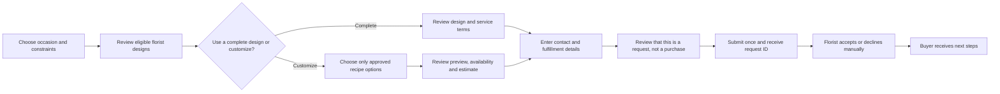
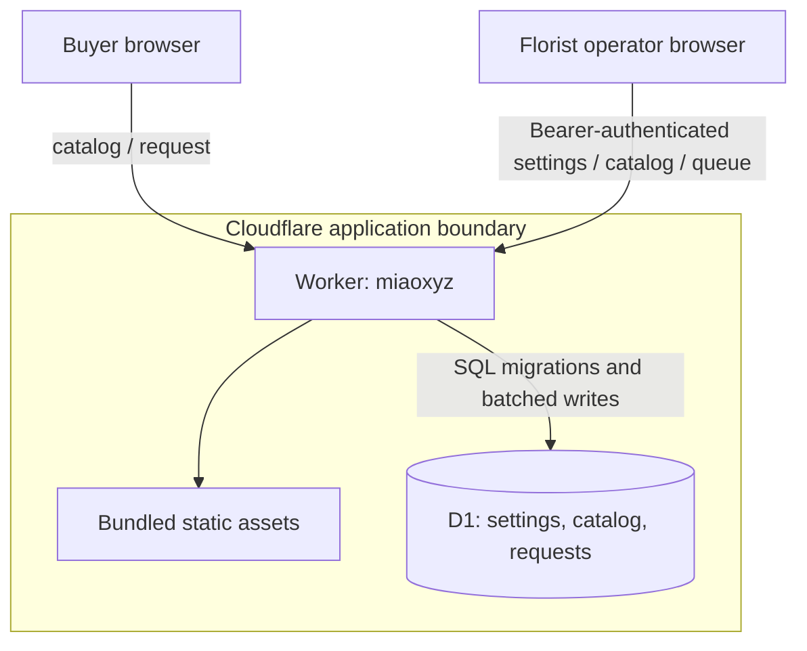

# MiaoXYZ Bouquet Commerce

**Join:** `miaoxyz-bouquet-commerce@0.3.0` · **As of:** 2026-10-28 · **Accountable document owner:** Product Owner
**Grounding state:** A Cloudflare Worker and D1 implementation candidate now exists in the canonical `agentic-graph` Dev source lane, based on fetched `origin/main` revision `d7b367354a4875726965bdf342aa1ab618d6075c`; the loopback Worker preview renders eight synthetic designs in memory, labels sample prices, and disables request submission. Use `?preview=empty` to inspect the actual local catalog. The composition editor covers florist-published recipes, layer edits, wrapping finishes, comparison, history, and tab-local snapshots. No florist catalog records, immutable release, remote Dev deployment, Production deployment, customer research, privacy approval, data region, or market evidence is recorded.

**Governing baseline:** [PRD, TAD & ADR Guidelines](https://github.com/huijoohwee/huijoohwee.github.io/blob/b10771228c625fa2167a663d63d09af9f1f2f2b9/guidelines/prd-tad-adr-mvp-gtm-guidelines.md), version 3.4.0, source revision `b10771228c625fa2167a663d63d09af9f1f2f2b9`. The PRD, TAD, ADR, MVP and GTM sections below share this exact continuity revision.

## Product Context and CID

**Context:** A single florist needs a clear way to present arrangements, help a gift buyer make a confident choice, and receive a complete request that staff can fulfill. The initial service area and buyer pain are hypotheses pending direct evidence.

**Intent:** For a buyer selecting a gift bouquet, reduce decision effort and avoid unclear price, availability, and delivery expectations while giving the florist a manageable order-intake path.

**Directive:** Specify and validate a small, mobile-first bouquet shop with an original product identity, florist-controlled catalog, constrained custom arrangement, and explicit order-request confirmation. Do not imply payment, stock reservation, delivery, or demand until separately evidenced.

**Role → Action → Outcome:** Product Owner → define the target buyer, journey, evidence threshold and bounded increment → a traceable specification whose value and readiness claims remain testable.

**Subject → Verb → Object:** Gift buyer → configures → florist-approved bouquet request.

**Opportunity “0”:** The opportunity is to make bouquet selection and custom requests easier to understand and operate. Buyer pain, willingness to pay, achievable fulfillment time, and florist economics remain unvalidated.

**Target outcome “1”:** During a four-week discovery and pilot window, a gift buyer in one florist-approved service area can configure a florist-published available bouquet and submit a complete, accurately priced request in five minutes or less on a mobile browser. The target is satisfied only when timed sessions and order-record checks meet VCCs in the PRD; no such evidence exists yet.

## PRD: Product Requirements

### Problem Statement

**Pain hypothesis P-01 — choice uncertainty:** A buyer may not know which bouquet suits the occasion, recipient, budget, or delivery window. This is unvalidated until supported by observed sessions, interviews, support records, or paid behavior.

**Pain hypothesis P-02 — customization ambiguity:** A buyer may want to adjust a florist’s design but cannot tell which changes are available, how they affect price, or whether substitutions are acceptable. This is unvalidated.

**Pain hypothesis P-03 — order rework:** A florist may receive requests missing a date, service area, selected design, or buyer contact, then spend time clarifying the order. This is unvalidated and requires an operator baseline.

### Personas and Jobs

| Persona | Job to be done | Evidence status | Exclusion |
|---|---|---|---|
| Gift buyer | Choose a fitting bouquet, stay within a spend limit, state the delivery or pickup need, and know what happens after requesting it | Hypothesis; interview and behavior evidence outstanding | No account, subscription, or AI concierge required |
| Florist / order operator | Publish current designs and availability, review requests, accept or decline, and keep the buyer informed | Hypothesis; workflow observation outstanding | Multi-location inventory and automated procurement are out of scope |
| Recipient | Receive a suitable, presentable arrangement with an optional personal message | Beneficiary; no direct account or data collection | Recipient profiling is out of scope |

### User Journey Stage

Discovery → compare florist-approved options → configure or choose a design → review price and service conditions → submit an order request → florist accepts or declines → buyer receives the next-step instructions → order is fulfilled manually.

The request is not a payment, confirmed order, or stock reservation. The interface must state that distinction before submission and in the confirmation.

**Reach:** Mobile and desktop browsers are in scope. Catalog retrieval and request submission require a network connection. Buyers may explicitly save up to eight composition snapshots in the current browser tab session; snapshots contain only florist-catalog choices and are not synchronized or submitted. Offline catalog browsing, cross-device draft sync, and offline submission are out of scope and must be disclosed.

### User Stories and MoSCoW

| ID | User story | Priority | Provisional ROI¹ | Incremental monthly TCO estimate¹ | VCC |
|---|---|---|---:|---:|---|
| PRD-01 | As a gift buyer, I want to filter florist-approved designs by occasion, palette, service date, and spend limit, then compare up to three so I can reach a suitable choice quickly | Must | 18.18 | S$10 | VCC-01 |
| PRD-02 | As a gift buyer, I want to edit the florist-published flower recipe, size, stem profile, ribbon, wrapping, and individual flower varieties and transforms, navigate the bouquet preview, and see the estimate update so I can personalize and inspect the approved offer | Must | 11.63 | S$15 | VCC-02 |
| PRD-03 | As a gift buyer, I want to review the full request and submit it without creating an account so the florist can confirm availability and next steps | Must | 13.16 | S$20 | VCC-03 |
| PRD-04 | As an order operator, I want a protected queue with request details and a small status lifecycle so no submitted request is silently lost | Must | 10.00 | S$25 | VCC-04 |
| PRD-05 | As an order operator, I want to revise the catalog and service area without changing application code so published availability stays under florist control | Should | 4.00 | S$15 | VCC-05 |

¹ Planning values only, not measured economics or vendor quotes. Illustrative formula from the economics guideline: `(impact × estimated monthly reach) / (estimated active build hours + incremental monthly TCO + monthly token cost)`. Inputs: PRD-01 impact 4, PRD-02–04 impact 5, PRD-05 impact 3; reach 100 sessions per feature per month; active build estimates 12, 28, 18, 25 and 60 hours; incremental monthly TCO S$10, S$15, S$20, S$25 and S$15; token cost S$0 because no AI is in scope. The score is not a cross-feature financial forecast; replace every input with observed or quoted evidence before an investment decision. Proposed total pilot infrastructure ceiling: S$100/month, subject to owner approval before any paid commitment. The actual TCO is unknown.

**Per-feature ceilings:** PRD-01: 12 active build hours, 0 model tokens, first suitable design ≤2 minutes and at most three compared designs; PRD-02: 28 active hours, 0 model tokens, five florist-controlled choice/finish groups, at most 30 stems, price update ≤1 second, 50 local undo/redo points, and eight tab-local snapshots; PRD-03: 18 active hours, 0 model tokens, one submit plus at most two automatic retries, then stop and preserve the in-memory composition; PRD-04: 25 active hours, 0 model tokens, one operator state transition per request at a time; PRD-05: 60 active hours, 0 model tokens, one catalog revision at a time. A request write uses at most three network attempts total, then opens the circuit for that request and surfaces a retryable error. These bounds are planning estimates and may be narrowed by implementation tasks, never exceeded without a successor decision.

### Acceptance Criteria and VCCs

All checks below are planned hosts, not commands that exist or have passed. Each VCC becomes satisfied only after an invocable check, recorded result, and surface are attached as an Evidence Reference.

| VCC | Given / when / then | Planned check | Constraint |
|---|---|---|---|
| VCC-01 | Given the published catalog, when a buyer filters by occasion, palette, date, or spend and selects two or three eligible designs to compare, then the collection and comparison panel show only current florist-authored details; the empty state explains how to broaden a search | `catalog-discovery-vcc` — browser acceptance report with matching product IDs, price ordering, comparison count, and elapsed time | Published results use only current catalog data; synthetic fixtures are limited to a clearly labeled loopback preview and cannot be submitted; comparison is capped at three; keyboard and screen-reader operation remain available |
| VCC-02 | Given a valid florist-approved base recipe, when a buyer changes size, stem profile, wrapping finishes, individual flower varieties and quantities, layer positions, scale, rotation, or horizontal orientation, then the original SVG preview and integer estimate reflect the catalog revision; the buyer can pan and zoom the overall preview independently; undo, redo, same-session snapshot restore, and the submitted request snapshot reproduce the saved composition and layer transforms | `arrangement-pricing-vcc` — input/output fixture report for minimum, maximum, unavailable, layer move/scale/rotate/mirror, flower replacement, history, snapshot, request layout, view-navigation invariance, and stale-catalog cases | Currency is SGD; integer minor units only; layer transforms are stored with the request but do not change the florist-set estimate; whole-view navigation changes no composition, history, price, or saved snapshot; no generated image or external catalog call |
| VCC-03 | Given a valid request and service-area date, when a buyer reviews and submits it, then one request record is created with an immutable item/price snapshot and a clear “awaiting florist confirmation” response | `order-request-vcc` — API and browser result showing exactly one record for a retried idempotency key | No card data; no charge; no implied stock hold; retries cannot duplicate the request; optional delivery address is collected only for delivery |
| VCC-04 | Given an authorized operator, when the operator opens the queue and changes an eligible request state, then the new state and actor/time are recorded and the buyer-facing status remains accurate | `operator-queue-vcc` — role/access and transition report | Unauthenticated users cannot see order or customer data; invalid transitions are rejected; logs omit message and address contents |
| VCC-05 | Given an authorized operator editing a catalog item, when valid changes are saved, then the new revision appears to buyers and prior submitted request snapshots remain unchanged | `catalog-revision-vcc` — before/after catalog and request snapshot comparison | Invalid prices, dates, service zones, or empty required fields cannot publish |

### Success Metrics and Time-to-Value

No product baseline has been measured. “Not measured” does not mean zero demand.

| Metric | Baseline | Pilot target | Window / check |
|---|---|---|---|
| First suitable design from landing | Not measured | Median ≤2 minutes for buyers who find a suitable option | Timed usability sessions; report sample size and unsuccessful sessions |
| Complete custom request | Not measured | Median ≤5 minutes; ≥90% of submitted requests contain every required field | First 20 eligible sessions or four weeks, whichever comes first; `order-request-vcc` |
| Price/availability mismatch | Not measured | 0 mismatches in first 20 submitted requests | Compare request snapshots to accepted catalog revision; stop accepting requests on a confirmed mismatch |
| Duplicate or lost requests | Not measured | 0 duplicates and 0 unexplained missing requests in first 20 submissions | Reconcile browser result, persisted request ID and operator queue |
| Buyer confirmation | Not measured | ≥90% can correctly state that submission is not a confirmed order or payment | Ask immediately after submission in each usability session |
| Monthly infrastructure TCO | No deployment selected | ≤S$100 proposed pilot cap; S$0 AI/token spend | Record actual invoices and usage; stop before paid service if cap or authorization is absent |
| Readiness | Local: `spec-complete`; delivered: `undocumented` | Derive again from Evidence References; no manual promotion | Every accepted VCC and every release/deploy event |

**Time-to-value estimate:** curated-design discovery ≤2 minutes; custom arrangement request ≤5 minutes. These are design targets, not observations. Re-measure in a clean browser with a first-time user before baseline.

### Pain-to-Feature Mapping

| Pain | Hook | Break | Fix | Close | Min-time / resource / max-value note |
|---|---|---|---|---|---|
| P-01, unvalidated | Start from the buyer’s occasion and constraints | A broad, unstructured catalog leaves the buyer comparing unsuitable options | Show florist-authored designs with explicit palette, occasion, service date and price bounds | Buyer can name a suitable design and see its service conditions | Reuse one catalog and one filter model; first deliver a small florist-approved assortment, not a recommendation engine |
| P-02, unvalidated | Let the buyer personalize within the florist’s real offer | Free-form customization creates stock and price ambiguity | Offer only valid recipe choices, visible substitutions, and deterministic price updates | Buyer sees and accepts a complete estimate before request submission | Reuse catalog ingredients, pricing rules and asset records; defer AI generation and novel inventory behavior |
| P-03, unvalidated | Show exactly what the florist receives | Missing details create clarification work and buyer uncertainty | Validate contact, fulfillment, date, message, selected items and price snapshot | Buyer gets one request ID and a clear next-step message; operator sees the same snapshot | Reuse the order record for buyer and operator views; avoid separate email, spreadsheet and order databases in the MVP |

### Min-Viable Scope, Exclusions and Dependencies

**Min-viable scope:** One florist, one currency, a florist-maintained catalog, mobile-first discovery, a bounded arrangement builder, a request-only flow, a protected staff queue, and manual acceptance/fulfillment. Provide original product copy and original or licensed image assets. The proposed first catalog may begin with six complete, florist-approved designs; final assortment depends on observed stock and margin.

**Won’t (this increment):** card collection or payment processing; automatic delivery booking or tracking; same-day promise; stock reservation; customer accounts; subscriptions; multi-merchant or multi-tenant operation; public reviews; AI recommendations or image generation; agent/MCP routes; loyalty points; automatic marketing; native mobile app; international currency; analytics that identify recipients; supplier, marketplace or social-network integrations.

**Dependencies:** A named florist decision-maker; source-of-truth prices, recipes, availability, substitution rules and service zones; permission to use original or properly licensed assets; a product implementation repository; an approved hosting and data-retention decision; and direct buyer/operator research. Each is currently a gap. Paid or personal-data processing is blocked until the owner approves the relevant TCO, privacy and operational controls.

**Originality and dependency boundary:** The product identity, wording, interaction details, catalog data, and visual assets are authored for this product or used under documented rights. Runtime uses this product’s catalog and bundled assets; buyer and operator flows have no external catalog or image dependency.

### Ecosystem Outcome and Evidence

| Participant / job | Value exchange / payer | Native owner at revision | Interface / authority | Evidence or gap | Cost, privacy and exit |
|---|---|---|---|---|---|
| Gift buyer | Receives clear choices and confirmation; pays the florist only after acceptance under a separately explained payment step | Product catalog and request service, implementation candidate at `0.3.0` | Buyer browser; may create a request only | P-01/P-02 are hypotheses; no interviews or payments observed | Minimize buyer data; no charge or account in MVP; delete request data under the approved retention rule |
| Florist operator | Receives complete requests and controls availability; receives order revenue if fulfilled | Operator queue and catalog editor, implementation candidate at `0.3.0` | Shared operator access key for local candidate; production access model is a release prerequisite | P-03 and operator workflow unobserved | One operator workflow; manual fulfillment; retain an export and rollback path |
| Recipient | Receives the intended arrangement and optional note | Florist-approved recipe and fulfillment procedure | No recipient account or direct system access | Beneficiary outcome not directly measured | Do not collect recipient profile data; message is optional and access-controlled |

**Ecosystem target:** Within the pilot, at least 18 of the first 20 valid requests are accepted without a clarification exchange caused by missing information; measure operator clarification events against request IDs. No ecosystem or revenue result is claimed before observation.

### Reuse Outcome

The canonical source is `agentic-graph` at baseline revision `d7b367354a4875726965bdf342aa1ab618d6075c`. The MiaoXYZ candidate is isolated under `cloudflare/workers/miaoxyz`; no pre-existing florist catalog, order store, customer identity, or florist workflow was found or reused. The implementation adds an original static buyer/operator surface, Worker API, and D1 schema. The exact candidate remains uncommitted and has no immutable release or deployment evidence.

### Open Questions

1. Which florist and delivery/pickup area are the initial service boundary?
2. Is buyer choice uncertainty, customization, or order rework the pain with highest observed frequency and willingness to pay?
3. What recipes, substitutions, price rules, lead times, delivery fees and capacity can the florist honor?
4. Who pays, what is the tested offer and price, and which manual payment step is acceptable after florist confirmation?
5. Which Cloudflare data region, privacy notice, retention period, consumer disclosures, tax handling and accessibility review apply in the selected jurisdiction?
6. Can the florist provide original product photography, or which licensed asset plan fits the budget?

## TAD: Technical Architecture

### Architecture Overview and Boundaries

The implementation candidate is a single-origin Cloudflare Worker named `miaoxyz`, with bundled HTML/CSS/JavaScript assets, Worker API handlers, and a D1 database. The production Wrangler environment declares `airvio.co/MiaoXYZ`; this route is source configuration only and has not been attached to the live zone. The Worker owns catalog reads and validation, deterministic price calculation, request idempotency, request transitions, staff settings, and retention cleanup. D1 stores catalog revisions, settings, request snapshots, state history and short-lived rate-limit digests. The bundled flower mark is original; product photography is not required by the UI.

No AI component, third-party product-data source, payment processor, delivery API, email sender, external account or agent gateway is used. The browser does not persist a buyer draft. The Worker is authoritative for price snapshots, availability rules and submitted requests. Store only the minimum data required for florist follow-up and fulfillment.

### User Journey Flow



Each editable flower is a named SVG group with a keyboard-accessible move target and, when selected, a resize handle. Dragging a flower moves that layer; dragging its handle, adjusting the selected-layer size control, using the wheel over the flower, or pinching the same flower changes its scale. Named native controls adjust horizontal/vertical position, size, rotation, variety, and horizontal mirroring; selected flowers can be brought into view or removed. Arrow keys move a focused layer, plus/minus resize it, and Home restores position and appearance. Selection uses visible SVG hit targets and semantic group, button, and slider roles; selected-layer controls are named form controls visible to accessibility and browser selection tooling. No generic HTML wrapper or `aria-hidden` decoration carries the interaction. Dragging blank canvas space pans the overall view; wheel or pinch away from a flower zooms the view, with visible zoom/reset controls and keyboard navigation. Layer transforms are saved in local undo/redo and same-session snapshots and included in the immutable request layout; they do not change the florist-set estimate. Whole-view position and zoom remain presentation state and do not change the composition, price, history, or saved arrangement.

### Workflow and Control Flow

```mermaid
sequenceDiagram
  actor Buyer
  participant Web as Buyer web app
  participant API as Cloudflare Worker
  participant DB as D1
  actor Staff as Florist operator
  Buyer->>Web: Set occasion, spend and service date
  Web->>API: Read eligible catalog revision
  API->>DB: Read catalog, availability and store settings
  DB-->>API: Approved revision and prices
  API-->>Web: Eligible designs and constraints
  Buyer->>Web: Configure and review request
  Web->>API: Submit validated request + idempotency key
  API->>DB: Recheck date, choices, price and persist immutable snapshot
  DB-->>API: Request ID and initial state
  API-->>Web: Awaiting florist confirmation; no charge made
  Staff->>API: Open queue; accept or decline request
  API->>DB: Record permitted transition and actor/time
  API-->>Web: Current buyer-facing state on next visit
```

### Data Flow and Lifecycle


**Flow anchor:** The user journey’s configuration → price review → request submission stages are the anchor for workflow, data and failure flows. The harness flow is explicitly inapplicable because this revision contains no AI-powered pipeline.

**Data contracts (implemented in the Worker):**

- `CatalogProduct`: product slug, plain-text description, integer SGD cents, tags, inclusive available dates, `choices.size` and `choices.stems`, three finishing groups (`ribbon`, `outerWrap`, `innerWrap`), florist-priced/color-coded flowers, and an included base recipe; each published catalog is an immutable revision.
- `CatalogOption` / `CatalogFinish` / `CatalogFlower`: bounded available option rows with unique IDs and plain-text labels; finish and flower colors use validated six-digit hex; flowers use a positive integer SGD-cent price per stem.
- `CompositionSnapshot`: one product and catalog revision, selected choices and finishes, and up to 30 uniquely identified flower quantities. Up to eight snapshots may be saved in tab session storage; no buyer details are included or sent to the Worker.
- `StoreSettings`: florist name, service area, price note, privacy notice/version, retention days, pickup/delivery flags and optional configured delivery fee in SGD cents. Delivery cannot be enabled without an explicit fee, including `0` if confirmed free.
- `OrderRequest`: random request ID, SHA-256 idempotency-key digest, request fingerprint, catalog revision, immutable product/choice/finish/flower/price/delivery-fee snapshot, buyer contact, fulfillment/date, delivery address only for delivery, optional note, privacy-notice version, status, timestamps and retention deadline. No payment credentials are accepted.

**Lifecycle:** The composition is held in browser memory while editing. If the buyer explicitly saves a snapshot, the composition (without contact, note, address, or request ID) remains in session storage for that tab session and is keyed by catalog revision; snapshots are not uploaded. Buyer contact details are sent only on submission. The buyer receives the random request ID in the immediate confirmation; there is no later buyer receipt lookup in this increment. Request content and contact details are visible to authorized operator sessions only. The operator configures a 1–365 day retention period; daily cleanup removes expired request records and status history. The applicable retention rule and data region remain unapproved, so real customer intake is disabled. Application logs exclude names, contact details, addresses, and message text.

**Price and state rules:** Estimated total = approved base-design price + selected size/stem-profile and wrapping deltas + selected flower subtotal − included base-recipe subtotal + the configured delivery fee when delivery is selected. All values use integer SGD cents and the Worker recomputes the total from the current catalog revision. Removing an included stem reduces the estimate at its florist-published stem rate; adding one increases it by that rate. The operator’s price note must disclose any other applicable charge or tax treatment; no tax rule is inferred by this app. A submitted request stores the exact displayed estimate and catalog revision. Allowed state transitions are `submitted → accepted | declined | cancelled`, `accepted → fulfilled | cancelled`; all other transitions are rejected and recorded. Manual payment follows acceptance outside this application; no charge or stock hold occurs here.

### Component Ownership and Contracts

| Component | Single responsibility | Contract | State / failure behavior |
|---|---|---|---|
| Bundled buyer web surface | Render filtered/compared designs, editable bouquet layers, review and immediate request confirmation | Same-origin API; catalog and request JSON; semantic keyboard-accessible controls; tab-local composition snapshots | Show empty catalog and paused-intake states; cap comparison at three and arrangements at 30 stems; discard unsaved work when the dialog closes |
| Worker API and pricing | Serve catalog/settings; validate catalog, choices, finishes, flower recipes, dates and price; create idempotent requests | JSON under `/api`; integer SGD cents; max 32 KiB request body and 256 KiB catalog; same-origin requests | Reject stale/invalid input; compute price from the current revision; return safe generic service errors |
| Operator surface | Edit settings/catalog and process allowed request states | Shared bearer token; immutable catalog revisions; status history records operator class and time | Reject invalid transitions; queue and catalog endpoints require authorization |
| D1 store | Own settings, catalog revisions, request snapshots, status history, rate-limit counters and operator event metadata | SQL migrations; batched writes; local synthetic D1 for preview | Production backup, restore and data export remain prerequisites; no production data is present |
| Static asset delivery | Serve bundled CSS, JavaScript and original SVG mark | Cloudflare Worker Assets binding; same-origin only | CSP and security headers; no remote image URLs or asset fetches |

### Topology



**Topology constraints:** Local development uses synthetic local D1 only. No Cloudflare Dev database or production database is provisioned by this candidate. Production route configuration targets `airvio.co/MiaoXYZ`; the exact route and zone binding must be reviewed through the protected release process. Production remains blocked until the owner approves a data region, privacy and retention notice, staff access policy, alerting, D1 backup/restore and rate-limit evidence. No real buyer data may be entered in local preview.

### Orchestration / Harness Flow

**Not applicable to the MVP:** There is no model call, autonomous agent, agentic loop, or external effect tool. Discovery reads remain zero-token. Do not add AI until a separate revision states typed input/output, per-call cost log, fallback, token ceiling, iteration bound, circuit-breaker, privacy basis and a buyer VCC. No token spend is planned for this revision.

### Quality, Privacy, Accessibility and Recovery

| Attribute | Target / constraint | Planned evidence |
|---|---|---|
| Price correctness | Every total equals the approved recipe formula and immutable catalog revision; use integer minor units | `arrangement-pricing-vcc`, property and edge-case report |
| Reliability | No submitted request is lost or duplicated; retried writes are idempotent | `order-request-vcc`, request reconciliation for pilot cohort |
| Performance | Catalog usable within 2 seconds at p75 on the declared pilot mobile profile; builder response does not wait on image downloads | Browser timing report on clean environment; profile to be selected |
| Accessibility | Full keyboard path for named SVG flower groups, layer movement and scale, canvas arrows, zoom keys and reset; visible SVG hit targets; semantic group, button and slider roles with names and state; named layer scale input and view instructions; screen-reader announcement of price and errors; minimum contrast per adopted accessibility standard; no color-only meaning | Automated accessibility report plus keyboard and screen-reader review |
| Security | Staff authorization required for all queue/catalog mutations; validation server-side; no card data; rate limit request endpoint | Access-control, schema and threat review |
| Privacy | Collect buyer contact only for requested follow-up; delivery address only for delivery; no recipient profile; no PII in logs | Data inventory and retention deletion evidence |
| Recovery | Daily encrypted backup during pilot; restore rehearsal before accepting real requests; documented request export | Backup and restore receipt; restore-time target ≤4 hours, subject to cost review |
| Cost | Proposed maximum S$100/month for the pilot; no paid overage or paid add-on without owner instruction; token spend S$0 | Monthly cost ledger; alert at 70% cap and stop new paid usage at 100% |

### AI, Agent and Invocation Readiness

The three dimensions are explicitly outside this product increment: Agentic OS-ready — out of scope; AI-agent-ready — out of scope; MCP gateway-ready — out of scope. The only launch surface is the ordinary buyer/operator web interface. No `/` command, `#` semantic route, `@` binding, or tool identity is declared; therefore no invocation register or agent-readiness rung is claimed. Reassess only if a product requirement introduces an agent route.

### Lane Topology and Deploy Boundary Register

| Boundary | From lane | To lane | Evidence Reference | Operator instruction | Rollback | State |
|---|---|---|---|---|---|---|
| Source review | Authoring | Mirror | None; not built | None | Retain prior source revision; reject candidate | `closed` |
| Customer availability | Mirror | Delivery | None; no deploy authorization | None | Restore exact prior delivered revision and verify request intake disabled during rollback | `closed` |
| Runtime recovery | Delivery | Previous delivery | None; no runbook or live deployment | None | Restore previous exact artifact and reconcile requests | `closed` |

No authoring-lane operation may change a mirror or delivery surface. Every promotion requires its own exact candidate, named check, independent evidence, operator instruction and rollback receipt.

### Deployment and TCO Variants

| Model | Fit | Planning cost | Risks / exit |
|---|---|---|---|
| Local rehearsal | Wrangler Worker, local D1 and synthetic data | No remote service created by local preview; not production proof | No real customer data; local storage can be reset; cannot accept real orders |
| Cloudflare Worker + D1 pilot | Implemented as the candidate Dev architecture; low operational burden | Actual bill and region are unknown; verify current D1/Workers quotas and backup, observability, and storage costs before approval | Region, export, deletion, backup/restore, quota enforcement and exact price remain gate items; exit by exporting D1 data and disabling intake |
| Self-managed single-region service | Alternative if the Cloudflare region, cost or export contract fails owner review | Not implemented or priced | Requires separate architecture and operations evidence; do not add as a second runtime now |

No paid service or production resource is authorized by this specification. Do not assume included quotas or existing accounts imply a zero-cost deployment. The Cloudflare architecture is selected for the Dev candidate; Production remains unresolved until region, price, backup/restore, privacy and export/exit evidence are approved.

### Codebase Grounding and Reuse Record

| Capability | Current owner / revision | Decision | Smallest proposed delta | Check / status |
|---|---|---|---|---|
| Buyer catalog and filtering | New `cloudflare/workers/miaoxyz/public` surface, baseline `d7b367354a4875726965bdf342aa1ab618d6075c` | New, product-owned schema and buyer view | Worker catalog API and bundled buyer page | Local empty-state preview rendered; catalog content remains absent |
| Design system and assets | New Worker `public` assets | New, original style tokens and SVG mark | Bundled CSS and original SVG mark; no external asset dependency | Code is present; product photo rights/need remain unassessed |
| Request storage and staff access | New Worker API and D1 migrations | New request store and operator queue | Bearer-token protected operator API and status history | Local schema migrated; production auth policy and data region remain unapproved |
| Deployment and observability | `cloudflare/workers/miaoxyz/wrangler.jsonc` | Cloudflare Worker + D1 for Dev candidate | Worker `miaoxyz`; production route config `airvio.co/MiaoXYZ` | Wrangler local preview and TypeScript check succeeded; no remote deployment, production IDs, backup/restore or billing evidence |

Canonical source baseline: `agentic-graph` revision `d7b367354a4875726965bdf342aa1ab618d6075c`. Candidate code is in `cloudflare/workers/miaoxyz`; the product PRD is colocated in `docs/documents`. Existing source capabilities were not reused. The candidate has not been merged, immutably published, deployed to Cloudflare Dev, or released to Production.

## ADR: Architecture Decision Records

### ADR-001: Cloudflare Worker and D1 for the Single-Florist Dev Candidate

**Status:** Accepted for the source implementation and local Dev preview; Cloudflare remote Dev and Production deployment remain blocked. Production region and operational controls are unresolved.
**Context:** The smallest product slice needs a buyer journey and operator-owned request queue. User requested Dev identity `miaoxyz` and Production path `airvio.co/MiaoXYZ`. The canonical repository has a protected release boundary; direct deployment from this lane is prohibited.

**Constraints before comparison:**

1. Buyer flow works on a mobile web browser and supports accessible controls.
2. Product controls catalog, price rules, request snapshots and data export.
3. No external catalog, image host, payment, email, delivery or analytics dependency.
4. No card storage or charge in the MVP; a buyer submits a request that staff may accept or decline.
5. Proposed paid-service ceiling is S$100/month; actual price and authorization remain unverified.
6. One florist and one service area only; data region must be selected before personal-data processing.

| Candidate pattern | Constraint disposition | 12-month TCO / FOSS-first | Pairwise relation |
|---|---|---|---|
| Cloudflare Worker + bundled static assets + D1 | Passes the local Dev slice; production region, cost and operations controls remain unresolved | Current price, quota and data-location evidence must be reviewed before a paid or real-data deployment | Selected to keep UI, API and request store in one Worker-owned boundary |
| Static catalog with manual contact outside the product | Fail `persisted request and operator queue` for this MVP; usable only as a discovery experiment | Lowest runtime complexity; staff re-entry and lost-request risk unmeasured | Excluded from the product MVP; may be used only as a separately labeled experiment |
| Hosted commerce platform | Pass buyer-flow feasibility only if export, data region, request-only semantics and staff controls are proven | License, transaction fee and migration cost unknown; not evaluated against cap | Incomparable until a candidate contract and price are grounded |

**Decision:** Implement one Cloudflare Worker named `miaoxyz`, with bundled static assets and a D1 binding. Local Dev uses local D1 and synthetic data. The production Wrangler environment declares `airvio.co/MiaoXYZ` and a separate D1 binding with placeholder IDs that must be replaced only through approved resource provisioning. No production route or database has been created by this lane. Intake remains gated by explicit store settings, privacy, region, backup/restore and rate-limit review approvals, operator and rate-limit secrets, a published catalog and approved retention/service details.

**Rationale:** One Worker owns price validation, request lifecycle, operator routes and same-origin assets. D1 migrations make the request store explicit, while local D1 keeps the current preview synthetic. No payment data, purchase charge, stock hold, email sender or external image service is introduced. The stack is reversible by exporting catalog/request records and recreating the documented schema in a successor architecture.

**Consequences:** D1 migrations, shared bearer-token operator access, a configurable retention rule, scheduled deletion and HMAC-derived short-lived rate-limit counters are implemented. Role-specific identity, audit ownership, backup/restore, privacy notice approval, region selection, quota/cost evidence and actual service operations remain open. Manual payment and fulfillment remain outside the app.

**Recovery / revisit trigger:** Reopen if region, cost or export review fails; if production recovery cannot be demonstrated; if the florist cannot maintain current availability; or if customer research shows request-only intake blocks conversion. Preserve request exports and catalog revisions when changing provider or schema. Production release requires a reviewed exact candidate and the repository’s protected authorization workflow.

**Evidence:** Local D1 migrations applied; Worker TypeScript check passed; local Worker served the static preview and catalog empty state. No VCC has passed, no provider quote or data-region approval exists, no remote Worker deployment or live workload exists, and no customer payment has been observed.

## MVP: First Validated Slice

### Scope and Dependencies

**Projects:** PRD-01–PRD-04 · TAD buyer surface, catalog/pricing domain, request service, operator queue and relational store · ADR-001 at `miaoxyz-bouquet-commerce@0.3.0`.

The MVP is a request-only pilot for one florist in one approved service area. The florist provides the initial designs, recipe constraints, prices, substitutions, assets and availability. Buyers may choose a complete design or build within those constraints, review the exact estimated total, then submit a request. Staff must accept or decline before the buyer proceeds to manual payment. No charge or stock reservation occurs in the app.

For local interface review only, loopback hosts render eight synthetic designs and prices from in-memory browser data; add `?preview=empty` to load the actual local catalog. A visible banner identifies the synthetic preview, request submission stays disabled, and the fixture never enters D1 or the published catalog.

### Acceptance and Evidence Plan

| Feature | VCC | Evidence Reference | Local rung | Delivered rung |
|---|---|---|---|---|
| Discovery | VCC-01 | None; `catalog-discovery-vcc` planned | `spec-complete` | `undocumented` |
| Constrained arrangement | VCC-02 | None; `arrangement-pricing-vcc` planned | `spec-complete` | `undocumented` |
| Request intake | VCC-03 | None; `order-request-vcc` planned | `spec-complete` | `undocumented` |
| Staff queue | VCC-04 | None; `operator-queue-vcc` planned | `spec-complete` | `undocumented` |
| Catalog edit | VCC-05 | None; `catalog-revision-vcc` planned; Should, not a release blocker if initial catalog can be safely seeded | `spec-complete` | `undocumented` |

The rung labels above describe the written product criteria only. The Worker and browser implementation candidate exists, but no independent VCC result is attached. Source release, deployment, runtime evidence, first collection, and repeat demand have no evidence. Do not advance a rung until an independent evaluator consumes a named check result and surface.

### Demo Skeleton

| Beat | Bound | Demonstration |
|---|---:|---|
| Hook | 15s | Buyer states occasion, service date and spend limit |
| Probe | 40s | Show how the florist’s constraints narrow eligible options |
| Reveal | 150s | Build one permitted arrangement; show price and unavailable-option handling; Reveal = VCC-02 |
| Domain action | 50s | Submit one request and show the same immutable snapshot in the staff queue |
| Close | 25s | Show `awaiting florist confirmation`, no charge, and the next operator step |
| **Total** | **280s** | Below the five-minute demonstration bound |

Use synthetic data for rehearsal. A local rehearsal is not evidence of live inventory, payment, fulfillment, or demand.

### Domain-Object Rubric

**Domain object:** Florist-approved bouquet request, not the website or image preview.

| Level | Evidence needed | Current state |
|---|---|---|
| L0 — named | Request and recipient/buyer roles defined | Specified; implementation candidate exists but is not independently verified |
| L1 — composed | Item, recipe choices, service date and price snapshot form one valid request | VCC-02/03 specified; unproven |
| L2 — operational | Staff can accept/decline, fulfill, export and recover requests without silent loss | VCC-04 specified; operator process unobserved |
| L3 — measured | Accepted, fulfilled, refunded/declined, clarification, cost and repeat-use evidence reconciled | Not measured; not claimed |

Highest contiguous evidenced level: **L0 definition only**. The Worker candidate exists, but no VCC has evidence. Next blockers: florist workflow/data, privacy approval, production region and operational controls.

### Roadmap and Bounds

| Phase / outcome | Pain evidence / rank | Reuse / new delta / owner | Prerequisite / exit VCC | Bounds / wait condition | Stop, recovery / next check |
|---|---|---|---|---|---|
| 0 — validate pain and operating boundary | P-01–P-03 are unvalidated; prioritize highest observed frequency and WTP | Observe florist process and review the existing Worker candidate; Product Owner | 8 buyer interviews, 3 florist workflow observations and service zone named; log evidence and contradictions | 2 active weeks; no paid services; cap research and build estimates at 40 active hours before decision | Stop/pivot if fewer than 4 of 8 qualified buyers report recent choice difficulty or florist cannot maintain recipe/availability; next check at interview 8 |
| 1 — local demo slice | Validate discovery and pricing comprehension | One catalog, recipe and request flow; Engineering Lead | VCC-01–03 on synthetic fixtures; zero lost/duplicate requests in 20 replayed submissions | 5 active build days; ≤1 schema; ≤S$0 external spend; no customer PII | Roll back to synthetic-only demo on price mismatch or privacy/access failure; next check after evaluator report |
| 2 — bounded paid concierge pilot | Test demand and operations separately | Pilot one florist/service area; Product Owner | VCC-01–05; 20 real eligible requests; approved data/retention/deploy plan; request conversion and acceptance thresholds | 4 weeks or 20 requests; total spend ≤approved S$100/month ceiling; no automated payment | Stop intake on mismatched quote, missing order, security finding or cap breach; review after each 5 requests |
| 3 — repeatability decision | Measure first paid collection, repeat use, margin and support | Reuse existing product components if grounded; smallest new delta by ADR | At least 10 fulfilled paid orders and 3 repeat buyers within 60 days, or a documented stop/pivot decision | No expansion to another florist/zone until economics, capacity, and retention hold | Continue only if contribution margin is positive after materials, delivery and support; otherwise change offer or stop |

All estimates are active operator/build time, excluding external waits. An external wait has an owner, unblock condition and recheck event; no unsupported completion date is implied.

## GTM: Segment, Offer and Learning Loop

### Segment, Offer and Alternatives

**Initial segment hypothesis:** People buying a florist-made gift bouquet for an upcoming personal occasion, in one named local service area, who value a clear spend limit and the option to personalize. Exact geography is not confirmed.

**Buyer / user / payer:** Initially the gift buyer is the user and payer; the florist is the fulfillment operator and revenue recipient. The recipient is a beneficiary, not a system user.

**Offer hypothesis:** A florist-approved, price-transparent bouquet with bounded personalization and a manual confirmation step. Do-nothing, walk-in, phone/message order, and standard non-custom florist purchase are alternatives to measure. No differentiation or conversion claim is established.

**Price and packaging:** Test a small set of florist-approved price points and a transparent custom-choice premium during interviews and a paid concierge pilot. No public price, discount, delivery fee, tax treatment, or margin is set in this revision. Never show a price the florist has not approved.

### Market and Timing

No external market number is asserted. Before any market-size claim, estimate and reconcile two independent methods:

1. **Top down:** annual gift-occasion bouquet purchases in the chosen geography × online-reachable share × florist-addressable share × current average paid basket.
2. **Bottom up:** qualified local buyers reachable per month × observed order frequency × observed average accepted basket, capped by the florist’s weekly stem, arrangement and delivery capacity.

Record source, date, definition and uncertainty for every input. Until then, TAM/SAM/SOM, seasonality and “why now” remain gaps, not deck claims.

### Acquisition, Activation, Retention and Support

| Stage | Proposed low-cost experiment | Measure | Decision threshold |
|---|---|---|---|
| Acquisition | Invite qualified buyers through the florist’s existing consented audience and local partner introductions | Qualified visitors and source per visitor | Continue only when source and permission are recorded; no purchased contact list |
| Activation | Ask visitors to find a design or complete a custom request in a moderated session | Time to suitable choice, completion, misunderstanding and abandonment | Target VCC-01/02/03 metrics; revise if >10% think a request is already paid/confirmed |
| Conversion | Offer a manual paid concierge order after florist acceptance | Requests accepted, invoices issued, payment collected, fulfillment completed | Mechanism remains unproven until a payment receipt and fulfilled order reconcile to one request ID |
| Retention | Ask fulfilled buyers whether they return for another occasion within 60 days | Repeat paid order rate and cohort | Do not claim retention from email opens, waitlist, or a second session alone |
| Support | Track clarification contacts, substitution disputes, cancellations and minutes per request | Operator minutes and avoidable rework per request | Pivot if support time erases measured contribution margin or florist capacity |

No customer marketing message or public launch is authorized by this specification. Any future campaign must use a lawful, consented audience and an independently reviewed claim.

### Monetization and First-Dollar Path

| Stream | Segment exists now | Distance to first dollar | Mechanism | Demand | Collected revenue |
|---|---|---:|---|---|---|
| One-time florist bouquet order | Unverified | 1 — nearest test | Not proven; manual invoice/payment after florist acceptance | Not validated | None evidenced |
| Paid personalization premium | Unverified | 2 | Not proven; test only after base order succeeds | Not validated | None evidenced |
| Repeat occasion reminder or subscription | Unverified | 3 | Not designed | Not validated | None; Won’t this increment |
| Software subscription to other florists | No target segment research | 4 | Not designed | Not validated | None; Won’t this increment |

Separate order submitted, order accepted, payment collected, revenue recognized and order fulfilled. A displayed estimate or unpaid invoice is not a first-dollar claim. The nearest path is a florist-accepted one-time order with a reconciled payment receipt; only run it after operational, privacy and commercial prerequisites are approved.

### Assumptions and Financial Viability

| ID | Assumption | Value / status | Evidence owner | Next check |
|---|---|---|---|---|
| A-01 | Local gift-buyer demand is reachable through one florist | Unknown | Product Owner | Interview and source-qualified pilot traffic |
| A-02 | Buyers will pay for florist-approved customization | Unknown; price points to be tested | Florist / Product Owner | Paid concierge offer and collected-payment reconciliation |
| A-03 | Florist can keep recipes, prices and availability current | Unknown | Florist operator | Three workflow observations and 20-request pilot |
| A-04 | Pilot can stay within S$100/month external service spend | Proposed cap, not a quote | Financial Owner | Provider-free local rehearsal, then compare exact managed/self-managed prices |
| A-05 | One paid order has positive contribution margin | Unknown | Financial Owner | Materials + labor + delivery + support + fees per fulfilled request |

Do not publish a financial forecast from these assumptions. Before capital or expansion decisions, build the linked income, cash-flow and balance-sheet model with Base/Downside/Upside, cash floor, unit economics, tax/fee treatment, labor, inventory waste, fulfillment capacity and actual operating receipts. Bootstrap is the provisional funding posture; no raise, instrument or amount is proposed.

### Coverage Record C01–C16

**Join:** `miaoxyz-bouquet-commerce@0.3.0` · **As of:** 2026-10-28 · **Owner:** Product Owner
**Disposition rule:** `covered` means the domain has a decision or explicit gap in this specification; it does not mean validated, implemented, funded, released, or ready. `deferred` names its dependency and revisit trigger.

| Domain | Decision | Source section@revision | Evidence / gap | Owner | Next check / trigger |
|---|---|---|---|---|---|
| C01 Purpose, customer and pain | covered | PRD@0.3.0 | Buyer, operator, beneficiary and P-01–P-03 hypotheses stated; no observed pain yet | Product Owner | Complete 8 qualified buyer interviews and 3 florist observations |
| C02 Market and timing | covered | GTM@0.3.0 | One-area segment hypothesis and two sizing formulas; all input data missing | Product Owner | Research and reconcile both methods before any market claim |
| C03 Offer and alternatives | covered | GTM@0.3.0 | Offer, price test and manual/do-nothing alternatives stated; WTP and differentiation unvalidated | Product Owner | Run paid concierge experiment after pilot prerequisites |
| C04 Product and experience | covered | PRD@0.3.0 | Mobile buyer journey, Must stories, accessibility constraints, TTV and VCCs stated | Product Owner | Prototype and clean-environment user sessions |
| C05 Architecture and data | covered | TAD@0.3.0 | Worker/D1 components, interfaces, data contracts, lifecycle and boundaries implemented in a source candidate; production region and operations remain open | Engineering Lead | Review exact candidate, region, backup/restore and privacy controls before deployment |
| C06 Quality, security and AI | covered | TAD@0.3.0 | Failure, privacy, recovery and accessibility targets stated; no AI; no implementation evidence | Engineering Lead | Threat/accessibility review and VCC evidence before pilot |
| C07 Decisions and tradeoffs | covered | ADR@0.3.0 | Cloudflare Worker + D1 selected for source candidate; production route configured in source only; production region/cost unresolved | System Architect | Revisit on region, quote or TCO evidence |
| C08 Smallest validated slice | covered | MVP@0.3.0 | Request-only single-florist slice, five VCCs and demo defined; no VCC has evidence | Product Owner | Complete discovery, then demo and VCC checks |
| C09 Acquisition through retention | covered | GTM@0.3.0 | Low-cost experiment, paid path, activation and retention metrics stated; cohorts absent | Growth Owner | Pilot result and 60-day repeat-use observation |
| C10 Business operations | covered | TAD@0.3.0 | One staff queue, manual acceptance/fulfillment, recovery and capacity checks proposed; workflow unobserved | Florist Operator | Observe three workflows; agree service and incident runbook |
| C11 Organization and obligations | covered | PRD@0.3.0 | Product, florist and engineering owners named by function; entity/IP/data/contract jurisdiction review open | Product Owner | Confirm legal entity, rights, jurisdiction and review owner before PII or paid orders |
| C12 Financial viability | covered | GTM@0.3.0 | Cost ceiling and assumptions registered; unit margin, three statements and scenarios not built | Financial Owner | Capture quotes and pilot receipts; build model before expansion |
| C13 Capital and milestones | covered | MVP@0.3.0 | Bootstrap is provisional; no ask or dilution; stage exits and stop thresholds defined | Product Owner | Revisit only if approved roadmap needs capital beyond bootstrap |
| C14 ADLC execution | covered | TAD@0.3.0 | Registered source lane and release boundary followed; local Worker preview and typecheck recorded; no remote publish/deploy receipt | Engineering Lead | Complete required VCCs and protected release workflow before any remote deployment |
| C15 Audience projections | deferred | GTM@0.3.0 | Deck, business plan and financial model not produced; market, price and cost evidence incomplete | Product Owner | Revisit after pilot evidence and linked model at successor revision |
| C16 Learning and next increment | covered | MVP@0.3.0 | Experiment window, thresholds, stop/pivot triggers, owners and successor conditions stated | Product Owner | Review at 8 interviews, every 5 pilot requests, and 60 days |

**Coverage:** 16/16 domains dispositioned; 15/16 applicable domains covered with explicit decisions or gaps; 1 deferred; 0 not applicable. C15 is deferred, not excluded. These counts measure documentary disposition only.

### Learning, Stop / Pivot and Successor

**Risk register:**

| Risk | Impact | Mitigation / recovery | Owner | Trigger / next check |
|---|---|---|---|---|
| Stale availability or recipe creates an unfulfillable request | Buyer trust and florist margin loss | Revalidate at submit; show substitution only with buyer consent; pause affected design | Florist Operator | Any mismatch; immediately reconcile all open requests |
| Price formula differs from the submitted estimate | Incorrect quote or dispute | Integer arithmetic, immutable revision, fixture coverage; stop intake on first mismatch | Engineering Lead | Any mismatch in VCC-02 or pilot; compare all requests since last known-good revision |
| Too few qualified buyers or low willingness to pay | No viable first-dollar path | Use interviews and a small paid concierge test before expanding features | Product Owner | Interview or pilot threshold missed; decide pivot/stop at the named checkpoint |
| Buyer or recipient data is exposed or retained too long | Privacy harm and operational trust loss | Minimize fields, isolate staff access, exclude PII from logs, rehearse deletion/export | Product Owner | Access anomaly, failed deletion, or privacy review gap; pause intake and follow incident procedure |
| Infrastructure spend exceeds the proposed ceiling | Unplanned cost | No paid commitment without approval; meter costs and stop new paid usage at 100% cap | Financial Owner | Alert at 70%; stop and choose a lower-cost option at 100% |
| Florist capacity cannot meet accepted dates | Late or cancelled gifts | Limit service dates by capacity; accept requests manually; publish no unverified delivery promise | Florist Operator | Any accepted order misses its committed date; pause affected date range |

**Learning checkpoint record:** At each scheduled observation, preserve `hypothesis_id`, target, actual numerator/denominator, cohort/window, Evidence Reference, cost, result, decision (`continue` / `pivot` / `stop`), owner, rollback and successor trigger. No checkpoint has run in this revision; actual values remain blank until observed.

**Continue:** At least 4 of 8 qualified buyers describe recent choice difficulty; at least 18 of 20 valid requests need no clarification caused by missing fields; no price mismatch, lost request, duplicate, or unauthorized data access occurs; and a fulfilled paid order has positive measured contribution margin.

**Pivot:** Buyer interest exists but customization reduces florist margin or adds excessive support. Narrow recipes, offer fixed designs, change price, or use a manual concierge flow; keep the same continuity ID and revise affected PRD/TAD/ADR/MVP/GTM sections together.

**Stop:** Fewer than 4 of 8 qualified buyers report the target pain, the florist cannot maintain current recipes/availability, request integrity or privacy cannot be proven within the S$100 proposed cap, or no positive-margin paid order is observed after 20 eligible requests. Record the decision and preserve the evidence; do not keep adding speculative features.

**Successor trigger:** Evidence-backed pain, grounded florist data, approved privacy/retention, selected production region and deployment controls open revision `0.4.0`. Reconcile criteria, architecture and decision impacts together; re-run affected VCCs and coverage. Keep documentation completion, local proof, source release, deployment, first collection and repeat demand as separate evidence events.

## Readiness, Evidence and Handover

- **Local artifact rung:** `spec-complete` as documentary status. An implementation candidate and local preview exist; this does not mean VCCs or production readiness are proven.
- **Delivered artifact rung:** `undocumented`; no immutable delivery or deployment receipt exists.
- **Product capability rungs:** No capability exceeds `spec-complete`; no VCC Evidence Reference has a recorded passing result.
- **Alignment gate:** Not run. Do not interpret the absence of a finding report as zero findings. Before baseline, produce grounding records, exact VCC hosts, independent evaluator evidence, complete coverage and a finding set with zero open blockers.
- **Current exact candidate:** This registered lane contains the Worker, D1 schema/migrations, bundled web surface, protected release path and this PRD, based on `agentic-graph` fetched `origin/main` revision `d7b367354a4875726965bdf342aa1ab618d6075c`. The lane is uncommitted; no immutable release or remote deployment receipt exists.
- **Costs:** Authoring cost and token usage were not measured as product ADLC receipts. Product infrastructure cost is unknown; the S$100/month figure is a proposed cap, not permission to spend or an observed quote.
- **Next bounded action:** Product Owner names the florist and service boundary, supplies source-of-truth catalog/fees/privacy details, approves data region and retention, and completes the discovery sample. Completion check: P-01–P-03 evidence is recorded, production data/backup controls are approved, all C01–C16 dispositions remain current, and each VCC has a named passing check before release.
